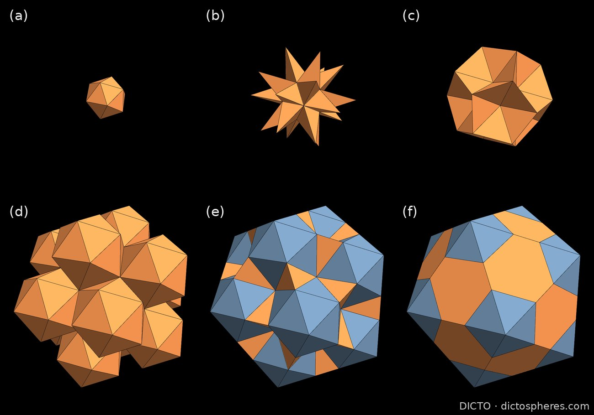
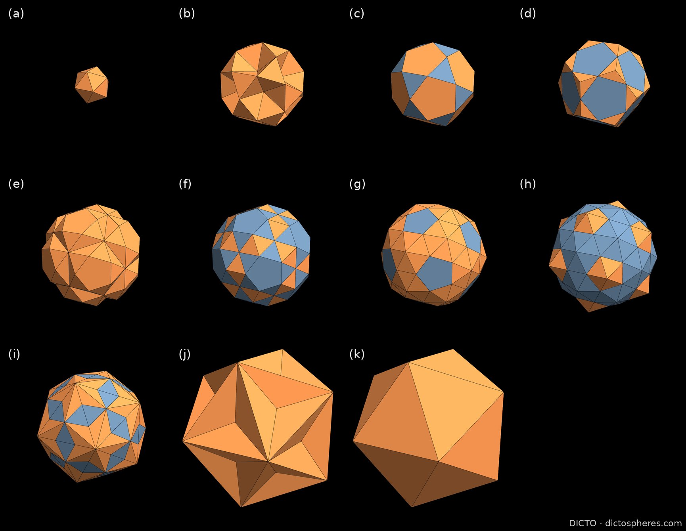
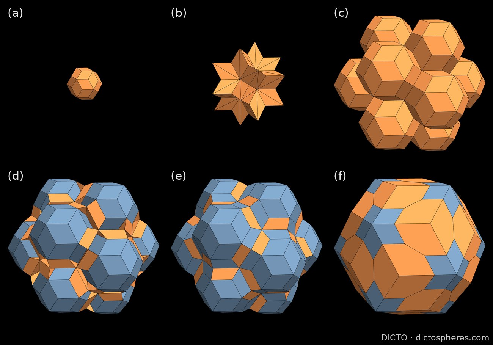
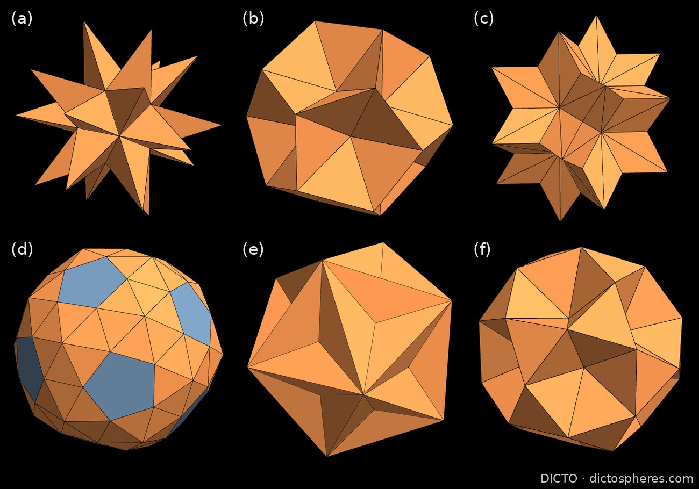
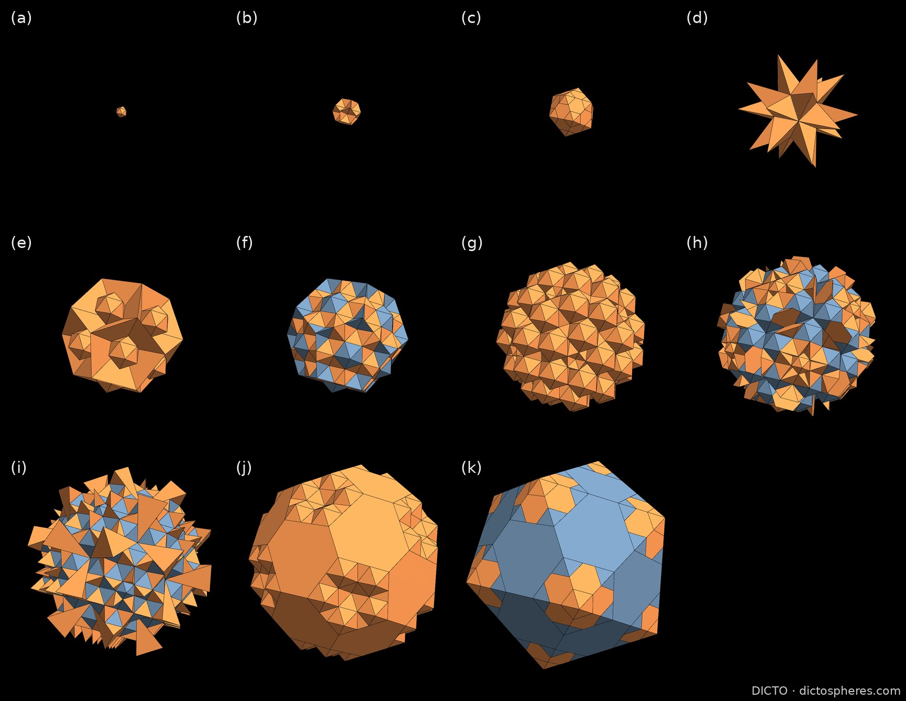
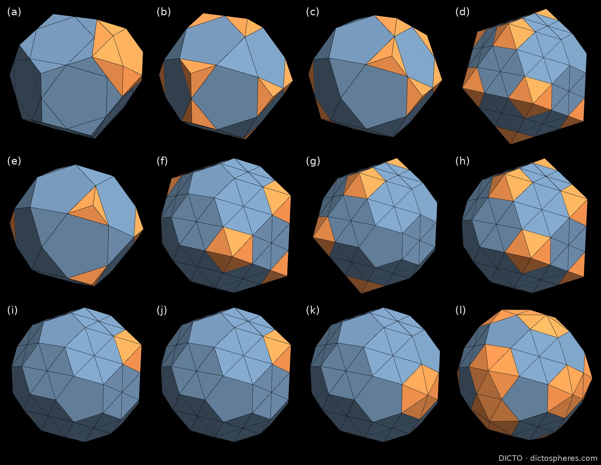

# Capturing the In-betweens: a Study of Transitional Polyhedral Shells

**DICTO** · dictospheres.com

*Draft, 13 October 2026. Not released. Computation, checking and drafting with Claude (Anthropic). The structures, their pieces and their names are DICTO's.*

---

## Abstract

DICTO's Chain of Karma, Spheres of Dharma and Bodhi Seed are exact icosahedral dissections: each grows a large polyhedron from a small core by adding rings of congruent pieces. Between the familiar solids at the start and end of each step lie the in-between stages, the **transitional shells**. Taking each stage as one solid, with its pieces fused, we find that the builds pass through celebrated polyhedra on the way:

- **Icosahedron + 20 CLEO is Kepler's great stellated dodecahedron.**
- **Adding 30 AXE turns it into the excavated dodecahedron**, a stellation of the icosahedron, with all 32 corners kept.
- **Adding 12 caps closes the dodecahedron.** The Dodecahedral Chain thus walks from the icosahedron to its dual through two star solids.
- **The Bodhi Seed's centre + 60 Vajra (fine) is the rhombic hexecontahedron.**
- **The Spheres of Dharma's seventh stage is a convex solid with 80 corners**, 12 regular pentagons, 30 rhombi and 60 triangles, every face tangent to one sphere. We did not find it in the catalogues we searched.

Every identification is checked against an independent construction to within 10⁻⁴. We describe all 21 piece types, show 45 further convex stages, and give cut-out nets so the in-betweens can be built by hand. The transitional shells now have their own group in the Polyhedraverse app.

---

## 1. Introduction

Scrubbing the Top shell slider in the Kaleidohedra app's Multi-shell chains world, DICTO saw that the in-between stages of his nested structures look strikingly different from the solids at either end of each step. He picked out about 11 on Chain step 2, 5 on the Lotus seed, 4 on the Dodecahedral Chain and 6 more on the other views. His idea: these forms may be known, but not as **transitional shapes between the well-known solids**, and the steps a model goes through as it builds are worth looking at in their own right.

This paper defines the stages exactly (Section 2), describes the pieces that build them (Section 3), and identifies the classical and new solids among them (Section 4). Section 5 shows the shells in the apps and as paper models.

Two of the three structures are members of DICTO ATOM-13×13, thirteen clusters of twelve around one [DICTO, ATOM-13×13]. The Lotus seed is its Icosa-13, and the Bodhi seed is its thirteen triacontahedra. So the transitional shells are also the shells through which those thirteens fill up into a single larger solid; the figures echo the ATOM-13 kits.

## 2. The structures and their stages

**The structures.** The Lotus seed is the icosahedron of edge φ², cut into 13 icosahedra, 60 AXE, 20 FUJI and 20 CLEO, 113 pieces in all [DICTO, Chain of Karma]. Replacing every icosahedron with a Lotus seed gives Samsara (Chain step 2, 1,569 pieces). Closing a grown core with 12 pentagonal caps gives the Dodecahedral Chain.

The Spheres of Dharma is a six-shell cycle of 237 pieces [DICTO, Spheres of Dharma]:

> icosahedron 1/φ → icosidodecahedron φ/2 → dodecahedron 1 → truncated icosahedron 1/φ → rhombic triacontahedron → icosahedron φ²

The outer icosahedron is φ³ times the inner one, so the cycle repeats. The Bodhi Seed is a rhombic triacontahedron of edge φ² holding 12 triacontahedra of edge 1 on its five-fold axes around one of edge 1/φ [DICTO, The Bodhi Seed]. Its gap is filled exactly by Kit A (Vajra (fine), Chatra, Mudra) or Kit B (Vajra (fine), Crown Jewel, Diadem L and R).

**Stages.** Every piece belongs to a ring: an orbit of congruent pieces at one distance from the centre. A *stage* is a union of rings around the core:

- **Main route:** rings added in order of distance.
- **Whole-ring stages:** any connected union of rings.
- **Partial-ring stages:** a symmetric part, half or cap of the next ring on a complete shell.

**Table 1.** How many in-betweens there are.

| Structure | Main-route steps | Whole-ring stages (convex) | Partial-ring stages |
|---|---|---|---|
| Spheres of Dharma (one cycle) | 11 | 107 (8) | 5,569 |
| Chain of Karma, Lotus seed | 6 | 7 (2) | 124 |
| Bodhi Seed, Kit B | 6 | 10 (2) | 363 |

**Fusing.** Each stage is taken as one solid: the outer surface of its pieces, with each face the visible part of the pieces' faces in one plane. The fused solid's volume equals the sum of its pieces' volumes in every case.

## 3. The pieces

Lengths are in the study's units (Lotus seed: icosahedra of edge 1; Bodhi Seed: copies of edge 1; Spheres of Dharma: dodecahedron of edge 1). Dihedral angles are interior.

**Table 2.** The 21 piece types.

| Piece (DICTO's name) | Where, how many | Kind | Corners / edges / faces | Edge lengths (count) | Interior dihedrals | Symmetry | Volume | Known as |
|---|---|---|---|---|---|---|---|---|
| **AXE** | Lotus 60 | tetrahedron, five edges 1 and one 1/φ | 4 / 6 / 4 triangles | 1 (5), 1/φ (1) | 41.81°, 63.43°, 79.19° | C2v (4) | 1/12 | Mosseri–Sadoc t6 at 1/τ |
| **CLEO** | Lotus 20 | trigonal pyramid: base 1/φ, sides 1 | 4 / 6 / 4 | 1/φ (3), 1 (3) | 63.43°, 79.19° | C3v (6) | (√5 − 1)/24 | Mosseri–Sadoc t4 at 1/τ; one point of the great stellated dodecahedron |
| **FUJI** | Lotus 20 | hexagonal pyramid on a 120° hexagon of sides 1, 1/φ | 7 / 12 / 6 triangles + 1 hexagon | 1 (9), 1/φ (3) | 37.38°, 41.81°, 142.62° | C3v (6) | (1 + 3√5)/24 | DICTO's |
| icosahedra | Lotus 1 + 12 | regular | | | 138.19° | Ih (120) | | |
| pentagonal cap | Dodecahedral Chain 12; Dharma 12 | equilateral pentagonal pyramid | 6 / 10 / 6 | all equal | 37.38°, 138.19° | C5v (10) | | Johnson solid J2 |
| **Stupa** | Dharma 12 | pentagonal pyramid: base φ/2, sides √3/2, apex inward | 6 / 10 / 6 | φ/2 (5), √3/2 (5) | 43.36°, 132.40° | C5v (10) | 0.19734 | DICTO's |
| **Vajra (twist)** | Dharma 20 | twisted triangular frustum: parallel triangles 1/φ and φ/2 | 6 / 12 / 8 triangles | 1/φ (3), φ/2 (3), √3/2 (6) | 99.26°, 110.91°, 113.80° | C3v (6) | 0.22215 | DICTO's |
| **Cleo-low** | Dharma 20 | trigonal pyramid: base φ/2, sides 1/2 (the dodecahedron's corner) | 4 / 6 / 4 | φ/2 (3), 1/2 (3) | 37.38°, 116.57° | C3v (6) | 0.016855 | the shape of Mosseri–Sadoc t3 at half size |
| **Monkey Staff** | Dharma 12 | twisted pentagonal frustum: pentagons 1/φ and 1 | 10 / 20 / 10 triangles + 2 pentagons | 1/φ (15), 1 (5) | 63.43°, 142.62° | C5v (10) | (11√5 − 15)/24 | DICTO's |
| t1 | Dharma 30 | tetrahedron | 4 / 6 / 4 | 1/φ (5), 1 (1) | 37.38°, 116.57°, 138.19° | C2v (4) | (√5 − 2)/12 | Mosseri–Sadoc t1 at 1/τ |
| **Shield** | Dharma 20 | very low regular-hexagon pyramid | 7 / 12 / 6 triangles + 1 hexagon | 1/φ (6), 0.651 (6) | 20.91°, 159.45° | C6v (12) | 0.06763 | DICTO's |
| **Vajra-blade** | Dharma 60 | tetrahedron with one mirror | 4 / 6 / 4 | 1/φ (3), 0.651 (2), 1.0898 (1) | 20.55°, 20.91°, 144°, 159.10° | Cs (2) | 0.011271 | DICTO's |
| **Sevenfold-blade** | Dharma 30 | 6 triangles + 1 quadrilateral | 6 / 11 / 7 | 0.7265 (2), 1.0898 (4), 1.5568 (4), φ² (1) | 72°, 85.66°, 108°, 112.53° | C2v (4) | 5 − 2√5 | DICTO's |
| **Cleo-low 2** | Dharma 20 | trigonal pyramid on the outer icosahedron's face | 4 / 6 / 4 | φ² (3), 1.5568 (3) | 26.26°, 134.93° | C3v (6) | 0.36892 | DICTO's |
| J11 | Dharma hinge 12 | gyroelongated pentagonal pyramid, edge 1 | 11 / 25 / 15 triangles + 1 pentagon | all 1 | 100.81°, 138.19° | C5v (10) | (25 + 9√5)/24 | Johnson solid J11 |
| **Vajra (fine)** | Bodhi kits A and B, 60 | irregular triangular bipyramid | 5 / 9 / 6 | 1/φ (2), 1 (3), 1.0515, 1.4734, 1.7013 (2) | 72°, 90°, 108°, 120° | Cs (2) | 0.20518 | DICTO's |
| **Chatra** | Kit A 60 | 3 triangles, 2 quadrilaterals, 1 pentagon | 7 / 11 / 6 | 0.9106 (2), 1 (5), 1.0515, 1.4734, φ (2) | 60°, 72°, 90°, 108°, 120° | Cs (2) | 0.86915 | DICTO's |
| **Mudra** | Kit A 60 | quadrilateral pyramid | 5 / 8 / 5 | 1/φ (2), 0.9106 (2), 1 (4) | 36°, 120°, 144° | C2v (4) | 0.09687 | DICTO's |
| **Crown Jewel** | Kit B 20 | 3 triangles, 3 pentagons, 3 hexagons | 14 / 21 / 9 | 0.5628 (6), 1 (6), 1.0515 (3), 2/φ (3), φ (3) | 36°, 90°, 120°, 144° | C3v (6) | 1.95764 | DICTO's |
| **Diadem L / R** | Kit B 60 + 60 | 2 triangles, 3 quadrilaterals; mirror pair | 6 / 9 / 5 | 0.5628 (2), 0.6498 (2), 1 (4), 2/φ (1) | 36°, 60°, 90°, 108° | C2 (2), chiral | 0.15674 | DICTO's |
| rhombic triacontahedra | Bodhi 1 + 12 | Catalan solid | | 1/φ, 1, φ² | 144° | Ih (120) | | |

Three features stand out:

- **The Bodhi pieces have clean angles.** Every dihedral angle of every Bodhi piece is a multiple of 6° [DICTO, Bodhi pieces study]. The Lotus and Dharma pieces carry the icosahedral angles 41.81°, 63.43°, 116.57°, 138.19° and 37.38°.
- **Pieces sit over faces or along edges.** The pyramids (CLEO, Cleo-low, Cleo-low 2, Shield, FUJI, Stupa, the caps) each stand on one face of the solid beneath; AXE, t1, Vajra-blade, Sevenfold-blade and the Diadems lie along its edges.
- **A new Mosseri–Sadoc likeness.** Cleo-low has the shape of the Mosseri–Sadoc tile t3 at half its tabulated size, joining AXE (t6), CLEO (t4) and t1.

**What each piece does.** The main routes (Figures 1 to 3) show each piece's role:

- **Lotus seed.** CLEO stands on each face of the core and makes the star (stage 2); AXE fills its 30 grooves (stage 3); the 12 outer icosahedra and outer AXE build a spiky 180-triangle stage; FUJI closes the large icosahedron.
- **Spheres of Dharma.** Vajra (twist) makes an icosidodecahedron with 12 pentagonal dimples and the 12 Stupas fill them; Cleo-low closes the dodecahedron; the 12 Monkey Staffs and t1 make the truncated icosahedron; Shield gives the 80-corner solid; the caps and Vajra-blade complete the rhombic triacontahedron; Sevenfold-blade gives an icosahedron with 20 dimples, and Cleo-low 2 fills them.
- **Bodhi Seed Kit B.** Vajra (fine) turns the centre triacontahedron into the rhombic hexecontahedron; the 12 copies, the Diadems and the Crown Jewels close the large triacontahedron.

## 4. Classical and new solids among the in-betweens

Each identification below was checked by `analysis/identify.py` against a solid built independently of the stage's data (25 checks, all passing, tolerance 10⁻⁴).

**4.1 Icosahedron + 20 CLEO = the great stellated dodecahedron.** Lotus seed stage 2 is the solid bounded by Kepler's great stellated dodecahedron (Kepler 1619). Its 20 outer corners are the star's 20 points; its 60 faces lie in the star's 12 pentagram planes; every face is a golden triangle (sides 1, 1, 1/φ, apex 36°); each plane carries a regular pentagram; its circumradius and volume match the formulas. It has 60 faces, 90 edges and 32 corners. Each CLEO is exactly one point of the star.

**4.2 + 30 AXE = the excavated dodecahedron.** Lotus seed stage 3 has the same 32 corners as stage 2. Its 60 faces are equilateral triangles lying in the 20 face planes of the core icosahedron, and its volume is the dodecahedron minus 12 J2 pyramids. This is the excavated dodecahedron, the Ef1g1 stellation of the icosahedron (Coxeter et al. 1938; Wenninger 1971, model 28). Adding 30 AXE changes every face while every corner stays put.

**4.3 The Dodecahedral Chain: icosahedron → great stellated dodecahedron → excavated dodecahedron → dodecahedron.** The Dodecahedral Chain's stages 2 and 3 are the same two solids at the same size, and stage 4 adds 12 J2 caps to close the regular dodecahedron, whose corners are the star's points. In four building steps the icosahedron becomes its dual through two classical star solids, a route made entirely of DICTO's pieces.

**4.4 Samsara.** In Chain step 2, stage 2 is the excavated dodecahedron at scale 1/φ and stage 4 is the great stellated dodecahedron at scale φ²: the same transition, repeated at two golden scales (Figure 5).

**4.5 Centre + 60 Vajra (fine) = the rhombic hexecontahedron.** Bodhi Kit B stage 2 has the 62 corners of 20 prolate golden rhombohedra around the centre, their volume, and 60 golden rhombi on the 30 face planes of the centre triacontahedron. This is the rhombic hexecontahedron (Unkelbach 1940), a stellation of the rhombic triacontahedron (Messer 1995). The Bodhi pieces study had shown that the 12 copies enclose it [DICTO, Bodhi pieces study]; here it is also reached from inside.

**4.6 The convex 80-corner solid.** Spheres of Dharma stage 7 is convex, with 12 regular pentagons, 30 rhombi (sides 0.65097, angles 56.68° and 123.32°) and 60 isosceles triangles. Its corners are the 60 of the truncated icosahedron and 20 on the three-fold axes, forming a regular dodecahedron. It is the truncated icosahedron with a Shield on each hexagon, at the exact height where the triangles of neighbouring Shields across each hexagon–hexagon edge lie flat as one rhombus. In Conway's notation it is the hexagon-kis truncated icosahedron k6tI in this flattened, rhombic form. **All 102 faces are tangent to one sphere**, of radius 1.5: it has an insphere, like a Catalan solid, while having three kinds of face. It is not an Archimedean, Catalan or Johnson solid, and we did not find it in Conway-notation or other catalogues searched, nor among the named relatives with 80 or 92 corners.

**4.7 Dimpled shells.** Two Dharma stages are elegant dimpled solids: the icosidodecahedron with 12 inward pentagonal pyramids reaching the core's corners (stage 2), and the outer icosahedron with 20 shallow inward pyramids whose apices are the Shields' apices (stage 10).

**4.8 Forty-five convex partial stages.** On complete shells, 45 of the Spheres of Dharma's partial-ring stages are convex, with 36 different face patterns of 17 to 86 faces (Figure 6): truncated icosahedra partly capped, dodecahedra partly truncated, and more, each a new convex form between two classical ones.

## 5. In the apps and in paper

**Polyhedraverse.** The transitional shells have their own group, **DICTO Transitional Shells**, in the Polyhedraverse app, each a single solid with every face in its piece's colour as in the app's views. It now holds seven: the great stellated dodecahedron and excavated dodecahedron (Lotus seed and Dodecahedral Chain stages 2 and 3), the Dodecahedral Chain's dodecahedron (stage 4), Lotus seed stages 4 and 5, the rhombic hexecontahedron (Bodhi Kit B stage 2) and the 80-corner solid (Dharma stage 7). The Kaleidohedra app's Multi-shell chains world shows every stage with its Top shell slider, and a movie slider that plays each build through its transitions is next.

**Cut-out nets.** `nets/transitional-shells-nets.pdf` gives 12 A4 pages of cut-and-glue nets for four shells, with numbered glue tabs, marked mountain and valley folds, lettered pieces and the DICTO mark:

- the great stellated dodecahedron (Lotus 2), 5 pieces;
- the excavated dodecahedron (Lotus 3), 6 pieces;
- the rhombic hexecontahedron (Bodhi Kit B 2), 6 pieces;
- the 80-corner solid (Dharma 7), 6 pieces.

Each net places every face once, true to its 3D shape, pairs every cut edge with a numbered tab, and has no overlaps (`nets/nets.py`, `nets/nets-checks.json`).

## Figures

**Figure 1.** Chain of Karma, Lotus seed main route: (a) core icosahedron; (b) + 20 CLEO, the great stellated dodecahedron; (c) + 30 AXE, the excavated dodecahedron; (d) + 12 icosahedra; (e) + 30 AXE; (f) + 20 FUJI, the icosahedron of edge φ². Orange: the pieces added at that step. One scale throughout.

**Figure 2.** Spheres of Dharma, one cycle: (a) icosahedron 1/φ; (b) + 20 Vajra (twist), the dimpled icosidodecahedron; (c) + 12 Stupa, icosidodecahedron; (d) + 20 Cleo-low, dodecahedron; (e) + 12 Monkey Staff; (f) + 30 t1, truncated icosahedron; (g) + 20 Shield, the convex 80-corner solid; (h) + 12 pentagonal caps; (i) + 60 Vajra-blade, rhombic triacontahedron; (j) + 30 Sevenfold-blade, the dimpled icosahedron; (k) + 20 Cleo-low 2, icosahedron φ².

**Figure 3.** Bodhi Seed Kit B: (a) centre triacontahedron; (b) + 60 Vajra (fine), the rhombic hexecontahedron; (c) + 12 triacontahedra; (d) + 60 Diadem L; (e) + 60 Diadem R; (f) + 20 Crown Jewel, the triacontahedron of edge φ².

**Figure 4.** The in-betweens of Section 4, each at its own scale: (a) the great stellated dodecahedron (Lotus 2); (b) the excavated dodecahedron (Lotus 3); (c) the rhombic hexecontahedron (Bodhi Kit B 2); (d) the convex 80-corner solid (Dharma 7; each rhombus shows as the two Shield triangles that form it); (e) the icosahedron with 20 shallow dimples (Dharma 10); (f) the icosidodecahedron with 12 pentagonal dimples (Dharma 2).

**Figure 5.** Samsara (Chain step 2), the app's 11 Top shell stages, one scale: (b) is the excavated dodecahedron at 1/φ and (d) the great stellated dodecahedron at φ².

**Figure 6.** Twelve of the 45 convex partial-ring stages of the Spheres of Dharma, each with a different face pattern; orange marks the partial ring.

## Data, scripts and checks

Everything is in this folder: `analysis/identify.py` (the 25 identification checks, with log and JSON), `analysis/pieces_analysis.py` (the piece table), `analysis/fuse_extra.py` and `analysis/data/fused-extra.json` (extra fused stages), `figures/compose.py` (the plates), `nets/nets.py` (the nets and their checks), `CHECKS.md` and `REFERENCES.md`. The stage counts and the catalogue are in the study folder above (`steps.py`, `stages.py`, `partials.py`, `catalogue.html`).

## Credits

DICTO: the structures, the pieces and all piece and structure names, the observation that started this study, and the plan for the apps. Classical solids are credited to their sources; the Mosseri–Sadoc tiles to Mosseri and Sadoc (1982), as tabulated by Koca et al. (2020).

## References

- DICTO, The Chain of Karma (2026), doi:10.5281/zenodo.23310541.
- DICTO, Spheres of Dharma (2026), doi:10.5281/zenodo.23310833.
- DICTO, The Bodhi Seed (2026), doi:10.5281/zenodo.23311353.
- DICTO, DICTO ATOM-13×13 (2026), doi:10.5281/zenodo.23333183.
- DICTO, Icosa-13 study and Bodhi pieces study, Kaleidohedra repository (studies/2026-10-10-icosa-13, studies/2026-10-12-bodhi-pieces).
- J. Kepler, *Harmonices mundi* (1619).
- H. S. M. Coxeter, P. Du Val, H. T. Flather, J. F. Petrie, *The Fifty-Nine Icosahedra* (1938; reprint 1982), doi:10.1007/978-1-4613-8216-4.
- M. J. Wenninger, *Polyhedron Models* (1971), doi:10.1017/CBO9780511569746.
- H. Unkelbach, Deutsche Math. 5 (1940) 306–316.
- P. W. Messer, Structural Topology 21 (1995) 25–46.
- J. H. Conway, H. Burgiel, C. Goodman-Strauss, *The Symmetries of Things* (2008), doi:10.1201/b21368; G. W. Hart, Conway notation for polyhedra, georgehart.com.
- R. Mosseri, J. F. Sadoc (1982); N. O. Koca et al., Dodecahedral structures with Mosseri–Sadoc tiles (2020).

DICTO · dictospheres.com
