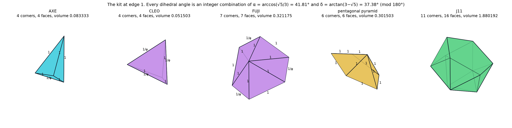
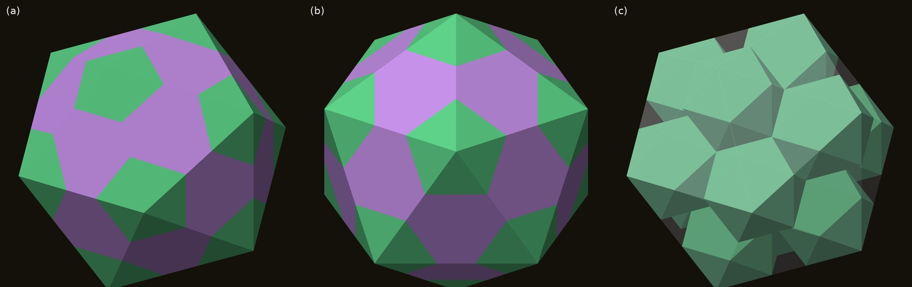
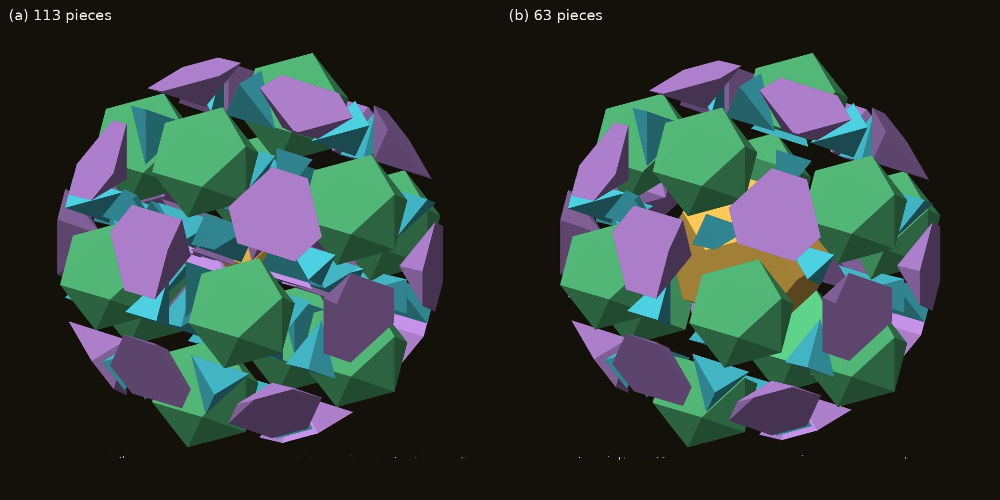
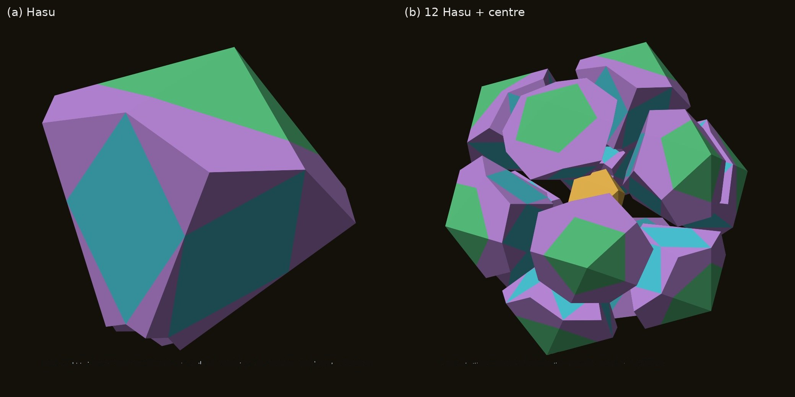
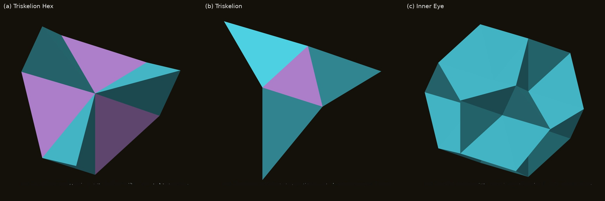
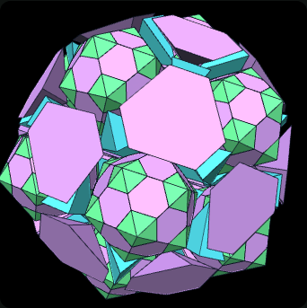
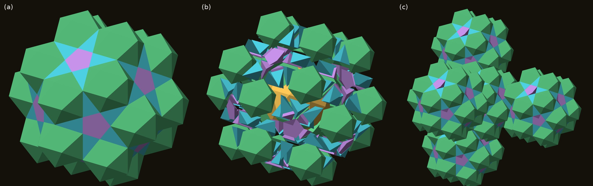

# AXE, CLEO and FUJI: the Gap Pieces of the Icosahedron

**DICTO** · dictospheres.com

*Draft, 14 October 2026 · not released · CC BY 4.0 on release. Computation, checking and drafting with Claude (Anthropic). The structures, the pieces and their names are DICTO's. Working title; the title is DICTO's to choose.*

---

## Abstract

Regular icosahedra cannot fill space: two of them meeting along an edge leave a gap of 83.62° around it. DICTO's thirteen-icosahedron cluster, the **Lotus seed**, closes every gap with just three small pieces, **AXE**, **CLEO** and **FUJI**. Together with whole icosahedra they fill an icosahedron of edge φ² exactly, in 113 pieces, or in 63 pieces when built as DICTO first built it: a dodecahedron, 12 J11 and then 30 AXE and 20 FUJI.

- **AXE and CLEO are two of the Mosseri–Sadoc tiles**, scaled by 1/τ. Sadoc and Mosseri made their tiles to describe icosahedral order in real materials. Here the same tiles arrive on their own, as the gap pieces of a cluster built from whole icosahedra.
- **FUJI, a hexagonal pyramid, is new.** We prove that it is not a union of Mosseri–Sadoc tiles at its own scale or larger. One proof uses the Dehn invariant and the other the angles of its hexagonal base.
- **The three pieces recur throughout DICTO's work.** The Dodecahedral Chain passes through the great stellated dodecahedron and the excavated dodecahedron. The dodecahedron is a small icosahedron with 12 caps, 30 AXE and 20 CLEO. The Chain of Karma repeats the Lotus seed at every scale, and the Stella-Corona grows the pieces into a network.

Every volume, angle and count is recomputed from the study data (CHECKS.json). We give printable nets so the Lotus seed can be built by hand.

---

## 1. Introduction

Twelve spheres fit around one, and the twelve centres are the corners of an icosahedron. Frank showed that this thirteen-atom cluster is more stable than the thirteen-atom pieces of the cubic and hexagonal crystals [Frank 1952]. It cannot be continued through space, however: the icosahedra around one another leave gaps that no number of icosahedra can close.

Sadoc and Mosseri described this icosahedral order through the 600-cell, a four-dimensional polytope whose 600 tetrahedral cells fit together perfectly on a curved three-dimensional sphere [Sadoc & Mosseri 1999]. Their work also gave six tetrahedral tiles with golden edge ratios, the Mosseri–Sadoc tiles, from which icosahedral structures are built in flat space [Mosseri & Sadoc 1982; Kramer 1982; Koca et al. 2020].

DICTO came to the same gaps from the other side, with whole icosahedra in flat space. His Lotus seed puts 12 icosahedra around a small one and fills what is left [DICTO, Icosa-13]. Two of the three pieces that do the filling turn out to be Mosseri–Sadoc tiles; the third, FUJI, is new. This paper describes the three pieces (Section 2), the Lotus seed they complete (Section 3), and the solids, chains and networks they build elsewhere (Sections 4 and 5). Section 6 proves FUJI's independence, and Section 7 gives the nets.

Units: the icosahedra have edge 1, and φ = τ = (1 + √5)/2.

## 2. Three pieces

Figure 1, at the head of the paper, shows the three pieces at the scale where they fill the Lotus seed.

| Piece | Shape | Edges | Volume | Credit |
|---|---|---|---|---|
| **AXE** | tetrahedron | five of length 1, one of 1/φ | 1/12 | Mosseri–Sadoc *t6* at scale 1/τ |
| **CLEO** | triangular pyramid | base equilateral 1/φ, side edges 1 | (√5 − 1)/24 | Mosseri–Sadoc *t4* at scale 1/τ |
| **FUJI** | hexagonal pyramid | base edges 1 and 1/φ alternating, all six side edges 1 | (1 + 3√5)/24 | new (DICTO) |

**AXE** is two equilateral triangles hinged at 41.81° (cos = √5/3). Two icosahedra sharing an edge leave 360° − 2 × 138.19° = 83.62° around it, as two gaps of 41.81°, one on each side. An AXE closes each one.

**CLEO** is a slender pyramid whose four faces meet at 63.43° along its long edges. Placed on a face of an icosahedron of edge 1/φ, twenty CLEOs make the spikes of Kepler's great stellated dodecahedron (Section 4).

**FUJI** has a hexagonal base with all angles 120° and sides 1 and 1/φ alternating. The base is cyclic: all six corners lie on a circle of radius √(2/3), which puts the apex at height 1/√3 with every side edge 1. FUJI sits in the corner where three icosahedra meet, with its apex at a corner of the dodecahedron inside the cluster.

**Figure 2.** The pieces at edge 1, every edge labelled: AXE, CLEO, FUJI, the pentagonal cap J2 and J11 [DICTO, Chain of Karma].

**Two angles.** All the dihedral angles of the three pieces are made of two angles, α = arccos(√5/3) = 41.81° and δ = 37.38° (FUJI's base angle on its short edges):

| Angle | As α, δ | Where |
|---|---|---|
| 41.81° | α | AXE's hinge; FUJI's base on its long edges |
| 37.38° | δ | FUJI's base on its short edges |
| 63.43° | π − α − 2δ | AXE's short edge; CLEO's side edges |
| 79.19° | α + δ | AXE's other four edges; CLEO's base |
| 116.57° | α + 2δ | the dodecahedron's dihedral angle |
| 142.62° | π − δ | FUJI's side edges |

These relations hold to 120 digits (integer-relation search, Icosa-13 study §9). The same two angles reappear in Section 6, where they make the Dehn invariants exact.

## 3. The Lotus seed

Twelve icosahedra placed on the five-fold axes of a small central icosahedron, parallel to it and slid inward until they meet, share 30 whole edges. Their inner rings are the 12 faces of a dodecahedron of edge 1. R. W. Gray described this arrangement in 2002 and noted that the 12 icosahedra outline a larger one [Gray 2002]; DICTO calls the cage **DESHI**. Gray did not fill the gaps; the Lotus seed does.

**Figure 3.** The Lotus seed: (a) the filled cluster; (b) down a five-fold axis; (c) its hull, a regular icosahedron of edge φ², over the cage of 12 icosahedra.

**The filling.** Thirty AXE close the outer grooves, thirty more close the inner ones, 20 FUJI fill the outer corners, and 20 CLEO fill the inner corners around a small icosahedron of edge 1/φ:

**I(φ²) = 12 I(1) + I(1/φ) + 60 AXE + 20 FUJI + 20 CLEO** (113 pieces, no overlaps, volume (235 + 105√5)/12 = φ⁶ V(I)).

The result is exactly a regular icosahedron of edge φ². Its 20 large faces are each three icosahedron faces and one FUJI base.

**Figure 4.** The Lotus seed pulled apart: (a) the 113-piece build; (b) DICTO's 63-piece build. Green: icosahedra and J11; cyan: AXE; purple: FUJI and CLEO; gold: the centre (a) and the dodecahedron (b).

**DICTO's 63-piece build.** DICTO first made this solid in the Polyhedraverse app on 5 October 2026, while working on a dodecahedron problem, by putting a J11 on every pentagon of a dodecahedron. Each J11, together with the cap hidden inside the dodecahedron, is one of the 12 outer icosahedra, so:

**I(φ²) = dodecahedron + 12 J11 + 30 AXE + 20 FUJI** (63 pieces).

The small centre, the inner AXE and the CLEOs merge into the single dodecahedron. Two standard solids and two gap pieces make it the easiest way to build the Lotus seed by hand (Section 7). The same move, a J11 on every unit pentagon, applied to an icosidodecahedron instead of a dodecahedron gives DICTO's **UNITY** [DICTO, Icosa-13].

**Figure 5.** (a) **Hasu**, the finned unit: an icosahedron with its share of the gap pieces (21 parts, 45 faces). (b) Twelve Hasu and the centre rebuild the Lotus seed, and each lifts straight out along its axis.

**Figure 6.** The pieces around each dodecahedron corner and the core. (a) **Triskelion Hex** = FUJI + 3 AXE. (b) **Triskelion** = CLEO + 3 AXE. (c) **Inner Eye** = I(1/φ) + 30 AXE + 20 CLEO, the dodecahedron with its 12 caps removed (volume 5φ/2).

The Triskelion has exactly the volume of the pentagonal cap J2, (5 + √5)/24.

## 4. The same pieces, other solids

**The dodecahedron.** Adding the 12 caps to the Inner Eye gives the dodecahedron, so

**D(1) = I(1/φ) + 12 J2 + 30 AXE + 20 CLEO.**

Built in that order, the stages are classical solids [DICTO, Capturing the In-betweens]:

- the icosahedron I(1/φ) **+ 20 CLEO is Kepler's great stellated dodecahedron**;
- **+ 30 AXE is the excavated dodecahedron**, a stellation of the icosahedron, on the same 32 corners [Coxeter et al. 1938; Wenninger 1971];
- **+ 12 caps is the dodecahedron.**

This is the **Dodecahedral Chain**: from the icosahedron to its dual through two star solids, with AXE and CLEO doing all the work.

**Figure 7.** The Lotus seed built outward: (a) core icosahedron; (b) + 20 CLEO, the great stellated dodecahedron; (c) + 30 AXE, the excavated dodecahedron; (d) + 12 icosahedra; (e) + 30 AXE; (f) + 20 FUJI, the icosahedron of edge φ². Orange: the pieces added at each step.

## 5. Chains and networks

**The Chain of Karma.** The Lotus seed is an icosahedron enlarged by φ², made of icosahedra and the three pieces. Replacing every icosahedron in it by a Lotus seed, and keeping the gap pieces whole, fills the icosahedra of edge φ⁴, φ⁶, … exactly. Steps 1 to 3 have 113, 1,569 and 20,497 pieces [DICTO, Chain of Karma]. AXE, CLEO and FUJI stay whole at each step, so they appear in every size, one step of φ² apart. The enlarged pieces cannot be cut back into the small ones (their Dehn invariants forbid it), so the Chain is a hierarchy with gap pieces in every size, rather than a self-similar tiling.

**Figure 8.** The Chain of Karma, step 2: 1,569 pieces filling the icosahedron of edge φ⁴.

**The Stella-Corona.** On an icosidodecahedron, DICTO places 20 icosahedra on the triangles and a **King of Pentacles** on each of the 12 pentagons: a J2, 10 AXE, 5 CLEO and a small J2, with a flat pentagram on top. The result is closed, every contact is a whole face, and its volume is (120 + 47√5)/3. Stella-Coronas that share icosahedra form a chain along a three-fold axis and a diamond network, the first periodic network of icosahedral clusters in this work [DICTO, Icosa networks].

**Figure 9.** The DICTO Stella-Corona: (a) closed; (b) pulled apart; (c) in its diamond network.

## 6. FUJI stands alone

AXE and CLEO are Mosseri–Sadoc tiles. Is FUJI made of them?

**Volume does not decide it.** FUJI has exactly the volume of 3 AXE + CLEO + the smallest Mosseri–Sadoc tile *t1* at scale 1/τ.

**The Dehn invariant does.** Two solids can be cut into each other only if they have equal Dehn invariants: the sum over edges of length ⊗ dihedral angle, with angles counted modulo rational multiples of π. With every angle written in α and δ, and every length as a + b√5:

| | 1-part (α, δ) | √5-part (α, δ) |
|---|---|---|
| FUJI | (3, −15/2) | (0, 3/2) |
| 3 AXE + CLEO + *t1′* | (27/2, 15/2) | (−1/2, 1/2) |

The √5-parts differ by (α + 2δ)/2 = (π − arctan 2)/2. Since cos²(arctan 2) = 1/5, and a rational multiple of π with rational cos² can only have cos² equal to 0, 1/4, 1/2, 3/4 or 1, arctan 2 is not a rational multiple of π. So the invariants differ, and no such dissection exists.

**No Mosseri–Sadoc mix at this scale or larger.** A search over all six tiles at four scales finds other mixes with FUJI's volume and Dehn invariant. The base of FUJI settles them all:

- Each 120° corner of the hexagon must be made as 60° + 60°, from two equilateral tile faces lying in the base. (The Mosseri–Sadoc faces have angles 60°, 36°/72° or 36°/108°.)
- At these scales the equilateral faces have side 1 or 1/τ. So the base must hold a side-1 triangle on each long edge and a side-1/τ triangle on each short edge.
- Those six triangles have a total area of 1.795, more than the hexagon's 1.669. Two of them would overlap, so no such dissection exists.

Mixes of smaller Mosseri–Sadoc tiles remain open. CLEO itself fits inside FUJI, with room to spare: it can grow to 1.023 times its size there.

So FUJI is a genuinely new piece, and the Lotus seed needs it. Koca et al. note that the Mosseri–Sadoc tiles alone cannot inflate the icosahedron past edge τ [Koca et al. 2020]. Taking whole icosahedra as pieces, with FUJI in their corners, the Lotus seed reaches φ², and the Chain of Karma carries on without end.

## 7. Build it

The nets (nets/axe-cleo-fuji-nets.pdf) print on A4 at 45 mm per unit, giving a Lotus seed with edges of about 118 mm. They contain one dodecahedron, 12 J11, 30 AXE and 20 FUJI, with CLEO for the 113-piece build and the star solids. Each net is checked: every face is congruent to the solid's, every edge is either a fold or a numbered glue pair, and nothing overlaps.

To build: glue a J11 on each face of the dodecahedron. Then fill the 30 grooves between neighbouring J11 with AXE, and the 20 hexagonal dents at the dodecahedron's corners with FUJI. The finished solid is a regular icosahedron.

## Credits

The Lotus seed, the 63-piece build, UNITY, the Chain of Karma, the Stella-Corona and the names AXE, CLEO, FUJI, Hasu, Triskelion, Triskelion Hex, Inner Eye, DESHI and King of Pentacles are DICTO's. AXE and CLEO are the Mosseri–Sadoc tiles *t6* and *t4* [Mosseri & Sadoc 1982; Kramer 1982; Koca et al. 2020]. The DESHI arrangement is R. W. Gray's [Gray 2002]. Study data, scripts and checks: studies/2026-10-10-icosa-13 and studies/2026-10-14-axe-cleo-fuji at https://github.com/DICTOR-Master/kaleidohedra.

## References

- DICTO, DICTO Icosa-13 (study, 2026-10-10), Kaleidohedra repository, studies/2026-10-10-icosa-13; DISCOVERIES #19.
- DICTO, The Chain of Karma (2026), doi:10.5281/zenodo.23310541.
- DICTO, Capturing the In-betweens: a Study of Transitional Polyhedral Shells (2026), doi:10.5281/zenodo.23345503.
- DICTO, Icosahedral networks (study, 2026-10-10), Kaleidohedra repository, studies/2026-10-10-icosa-networks; DISCOVERIES #20.
- F. C. Frank, Supercooling of liquids, Proc. R. Soc. A 215 (1952) 43–46, doi:10.1098/rspa.1952.0194.
- R. Mosseri, J. F. Sadoc, in *The Structure of Non-Crystalline Materials* (1982) 137–150.
- J. F. Sadoc, R. Mosseri, *Geometrical Frustration*, Cambridge Univ. Press (1999), doi:10.1017/CBO9780511599934.
- P. Kramer, Non-periodic central space filling with icosahedral symmetry using copies of seven elementary cells, Acta Cryst. A38 (1982) 257–264.
- N. O. Koca, R. Koc, M. Koca, A. Al-Siyabi, Dodecahedral structures with Mosseri–Sadoc tiles (2020), arXiv:2009.07048.
- R. W. Gray, More icosahedron scaling and packing (web, 2002).
- H. S. M. Coxeter, P. Du Val, H. T. Flather, J. F. Petrie, *The Fifty-Nine Icosahedra* (1938; reprint 1982), doi:10.1007/978-1-4613-8216-4.
- M. J. Wenninger, *Polyhedron Models*, Cambridge Univ. Press (1971), doi:10.1017/CBO9780511569746.
- M. Dehn, Über den Rauminhalt, Math. Ann. 55 (1901) 465–478.
- J. Kepler, *Harmonices mundi* (1619).

DICTO · dictospheres.com
