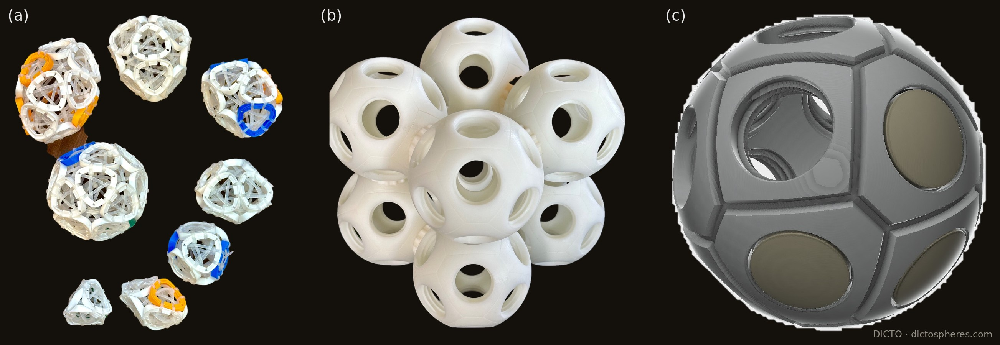
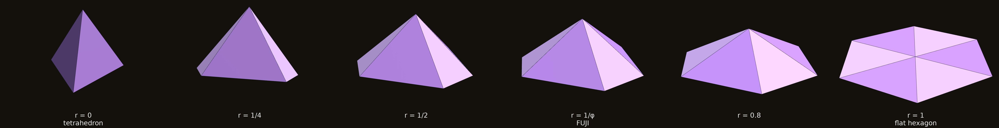
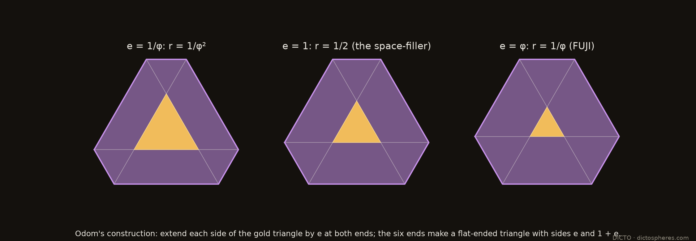
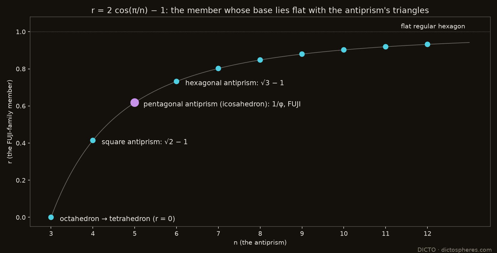
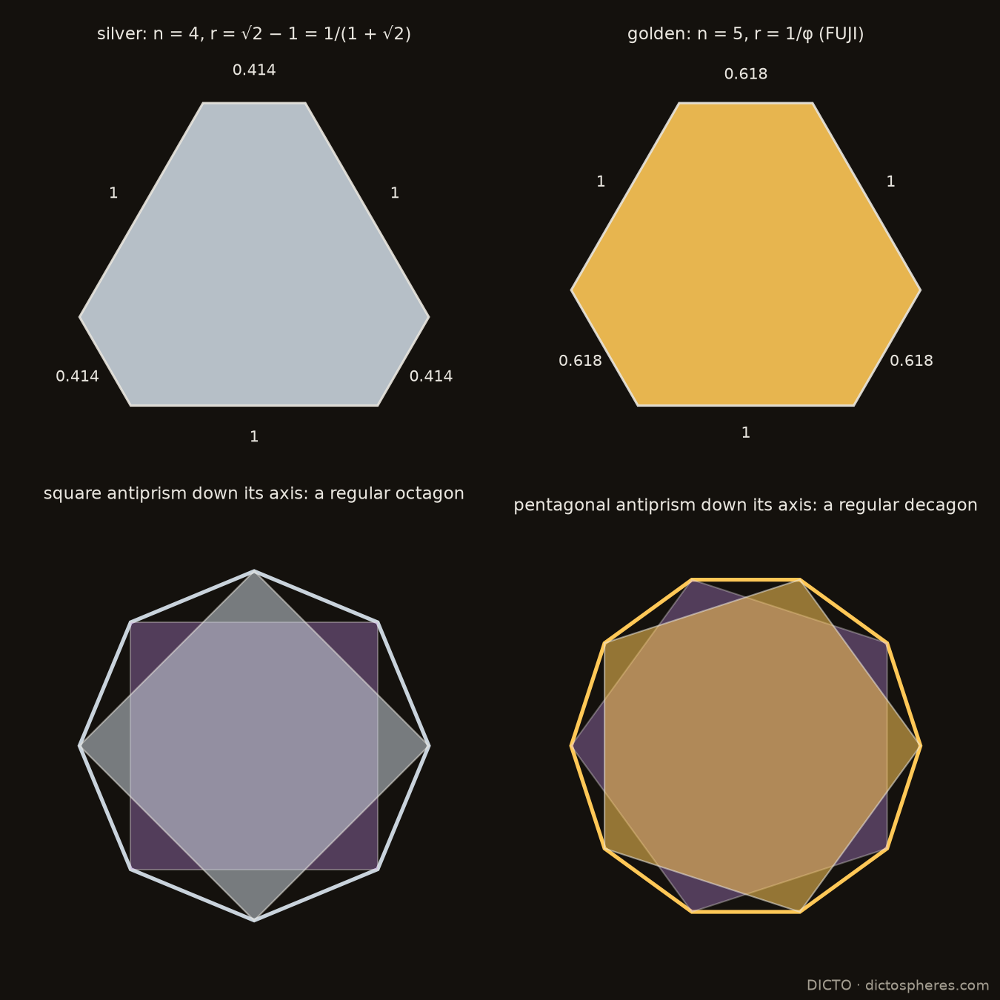
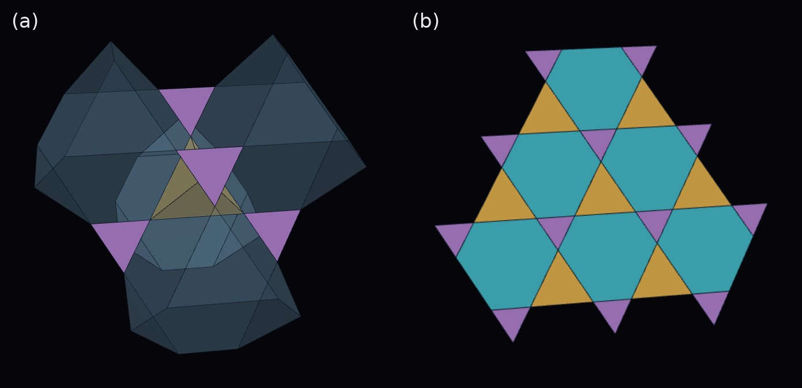
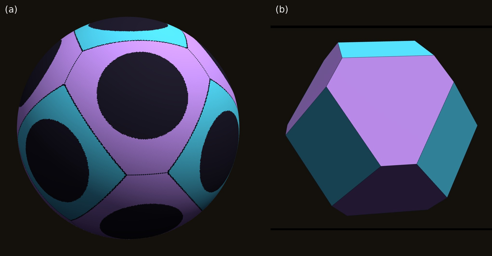
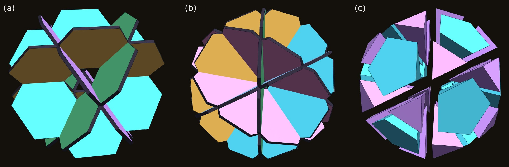
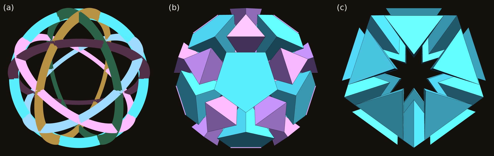

# The FUJI Family: Pyramids on Flat-Ended Triangles

**DICTO** · dictospheres.com

*Draft, 14 October 2026 · not released. Computation, checking and drafting with Claude (Anthropic). Working title.*

---

## Abstract

FUJI is the hexagonal pyramid that closes the corners of our thirteen-icosahedron cluster, the Lotus seed [1]. Its base is a **flat-ended triangle**: a hexagon with all angles 120° and sides 1 and 1/φ alternating. The same shape kept turning up elsewhere, in our cuboctahedral PET-bottle spheres and in the colouring of the Lotus seed, so we asked whether FUJI belongs to a family.

It does. Put an apex over a flat-ended triangle with sides 1 and r, with all six side edges of length 1. This gives a one-parameter family **FUJI(r)**, running from the regular tetrahedron (r = 0) through FUJI (r = 1/φ) to the flat regular hexagon (r = 1). We prove:

- **The base angles are cos L = (1 + 2r)/3 and cos² S = (2 + r)/(3(2 − r)).**
- **The antiprism theorem:** the member whose base lies in one plane with the triangles of the n-gonal antiprism is **r = 2 cos(π/n) − 1**. The octahedron gives the tetrahedron, the square antiprism √2 − 1, and the pentagonal antiprism (the middle of the icosahedron) gives FUJI.

The members turn up in several places:

- **Odom's golden hexagon** is FUJI's base, and every member's base is an Odom hexagon.
- **The space-filling truncated tetrahedron** of Damasceno, Engel and Glotzer has the r = 1/2 member's base as its faces.
- **In a breathing pyrochlore** the kagome hexagons are flat-ended triangles, with r equal to the breathing ratio.
- **Our dictospheres**, spheres with 14 bottle ports, are divided into curved squares and curved flat-ended triangles. Keeping an even margin round every port fixes the pattern, and its flat counterpart's triangles are the cuboctahedral member, r = (√3 − 1)/2.

---

## 1. Introduction

FUJI was found as a gap piece. In the Lotus seed, twelve icosahedra round a small one, the corners where three icosahedra meet are filled by a hexagonal pyramid with all six side edges 1, which we named after Mount Fuji [1]. It is not made of the Mosseri–Sadoc tiles that make its partners AXE and CLEO.

Its base had appeared before. Building cuboctahedral spheres of PET-bottle ports, we wanted sharp equilateral triangles round the ports and settled for blunted, flat-ended ones. Colouring the Lotus seed, we hoped for regular hexagons and found the same flat-ended triangles. Our DeltaZip and B1NR sculptures use rounded triangles, the curved form of the same idea.

**Figure 1.** Our sculptures. (a) DeltaZips: deltahedra built from rings tied with zip ties, each ring a rounded triangle. (b) Thirteen dictospheres joined, twelve round one. (c) A dictosphere design, with caps on some of its ports. Photographs and design: DICTO.

The same outline appears at the centre of the DeltaZips logo: the recycling symbol's three arrows make a triangle with its corners taken off. Measured on the logo as a flat-ended triangle with the same reach to the corners and to the sides, the symbol has r ≈ 0.79, and the DeltaZip ring photographed behind it r ≈ 0.48. Both lie well inside the family's range.

This paper takes FUJI's shape as the starting point of a family (Section 2), finds its bases in a classical construction (Section 3), proves which member belongs to which antiprism (Section 4), and follows the members into tilings, crystals and our sculpture (Section 5).

## 2. The family

**Figure 2.** FUJI(r) at one scale, all side edges 1: the tetrahedron (r = 0), r = 1/4, r = 1/2, FUJI (r = 1/φ), r = 0.8 and the flat hexagon (r = 1). Darker faces: the three equilateral triangles; lighter: the three isosceles triangles 1, 1, r.

**The base.** A flat-ended triangle with sides 1 and r is a big equilateral triangle of side 1 + 2r with an equilateral corner of side r cut off at each corner. In the literature it is the isogonal hexagon or truncated triangle t{3}. All six corners lie on one circle, of radius² (1 + r + r²)/3. So an apex at height h over the centre has all six side edges equal, and they are 1 when

  **h² = (2 − r − r²)/3.**

The volume is (√3/12)(1 + 4r + r²) h. The side faces are three equilateral triangles (on the long sides) and three isosceles triangles 1, 1, r (on the short sides), with apex angle 2 arcsin(r/2).

**The base angles** (proofs in the appendix):

  **cos L = (1 + 2r)/3** on the long sides,  **cos² S = (2 + r)/(3(2 − r))** on the short sides.

| r | member | height | angle L | angle S | side faces |
|---|---|---|---|---|---|
| 0 | regular tetrahedron | √(2/3) | 70.53° | | four equilateral |
| 1/4 | | 3/4 | 60° | 49.11° | |
| 1/2 | | 0.6455 | 48.19° | **41.81°** | |
| 1/φ | **FUJI** | 1/√3 | **41.81°** | 37.38° | isosceles faces are golden triangles (36°) |
| 1 | flat | 0 | 0 | 0 | six equilateral triangles in one plane |

Two of the angles are the same angle, 41.81° = arccos(√5/3). In the Lotus seed this is the gap two icosahedra leave either side of a shared edge. It appears as FUJI's long-side angle and as the r = 1/2 member's short-side angle. The formulas show why: cos² L = 5/9 exactly at r = 1/φ, and cos² S = 5/9 exactly at r = 1/2.

## 3. Odom's hexagon

**Figure 3.** Extend each side of the gold triangle by e at both ends: the six ends make a flat-ended triangle with sides e and 1 + e. With e = φ (right) it is FUJI's base.

George Odom's construction relates the golden ratio to the equilateral triangle [Wolfram Demonstrations, Hexagons and the Golden Ratio]. Extend each side of an equilateral triangle by the golden ratio at both ends, and the six outer points form a hexagon whose two side lengths are in the golden ratio.

Rebuilt here for any extension e: the six points always form an equiangular hexagon with sides e and 1 + e, a flat-ended triangle with r = e/(1 + e). So **every member of the family has an Odom hexagon as its base.** The golden extension e = φ gives r = 1/φ, FUJI's base. The extension e = 1 gives r = 1/2, the base of the member in Section 5.2.

## 4. The antiprism theorem

**Figure 4.** The member that matches each antiprism: r = 2 cos(π/n) − 1. FUJI is the five-fold member.

In the Lotus seed, FUJI's base lies in one plane with the icosahedron triangles on its long sides: 41.81° + 138.19° = 180°. For any solid X with unit triangles, the same happens when L + D_X = 180°, where D_X is the solid's dihedral angle at the triangle's edge. That is, when

  **r = (−3 cos D_X − 1)/2.**

| Solid (angle at the triangle's edge) | member r |
|---|---|
| icosahedron, pentagonal antiprism (138.19°) | **1/φ: FUJI** |
| cuboctahedron, triangle to square (125.26°) | **(√3 − 1)/2** |
| square antiprism (127.55°) | **√2 − 1** |
| rhombicuboctahedron, triangle to square (144.74°) | **(√6 − 1)/2** |
| octahedron (109.47°) | 0, the tetrahedron |

**Theorem.** For the n-gonal antiprism with unit edges, the matching member is **r = 2 cos(π/n) − 1**.

*Proof (outline; in full in the appendix).* Place the antiprism's corners at T_k = (R cos 2kθ, R sin 2kθ, h) and B_k = (R cos (2k + 1)θ, R sin (2k + 1)θ, −h), with θ = π/n and R = 1/(2 sin θ). The two equilateral triangles on the side edge T₀B₀ have their third corners T₁ and B₋₁, each √3/2 from the edge's midpoint M. A short computation gives (T₁ − M)·(B₋₁ − M) = −(4 cos θ − 1)/4. So cos D_n = (1 − 4 cos(π/n))/3, and r = (−3 cos D_n − 1)/2 = 2 cos(π/n) − 1. ∎

The antiprisms therefore index the family:
- n = 3, the octahedron, gives the tetrahedron;
- n = 4 gives the silver ratio's inverse, √2 − 1;
- n = 5, the icosahedron's middle, gives the golden ratio's inverse, FUJI;
- n = 6 gives √3 − 1;
- as n grows, r tends to the flat regular hexagon.

**Golden and silver.** The members for n = 4 and n = 5 are the two best-known metallic means. For n = 5, r = 2 cos 36° − 1 = φ − 1 = 1/φ, the golden ratio's inverse: FUJI. For n = 4, r = 2 cos 45° − 1 = √2 − 1 = 1/(1 + √2), the inverse of the **silver ratio** 1 + √2. So FUJI has a silver sister one step down the same formula, on the square antiprism, and seen down its axis that antiprism's outline is the **regular octagon**, as the pentagonal antiprism's is the regular decagon (Figure 5). The square family adds another silver number: its member on the rhombicuboctahedron is r = 1 − 1/√2. The golden members belong with icosahedral order and the silver ones with octagonal order (the Ammann–Beenker tilings are built on 1 + √2), so the family may be one place where the two meet; we have not yet followed that further.

**Figure 5.** The silver member (n = 4, r = √2 − 1) and the golden member FUJI (n = 5, r = 1/φ): their flat-ended triangles, and their antiprisms seen down the axis, the regular octagon and decagon.

## 5. Where the members live

### 5.1 FUJI in the Lotus seed

The Lotus seed is a regular icosahedron of edge φ², exactly: 12 icosahedra, a small centre, 60 AXE, 20 FUJI and 20 CLEO, or our 63-piece build of a dodecahedron, 12 J11, 30 AXE and 20 FUJI [1]. Each of its 20 big faces is three icosahedron triangles and one FUJI base. FUJI is the five-fold member of the family, which is why it belongs to the icosahedron.

### 5.2 The space-filling truncated tetrahedron (r = 1/2)

Damasceno, Engel and Glotzer studied truncated tetrahedra from the tetrahedron to the octahedron, and found that the member at truncation t = 1/2 fills space on its own [Damasceno et al. 2012]. Its four hexagons have sides in the ratio 2 : 1 (checked from their published corners): they are the r = 1/2 member's base, Odom's hexagon with e = 1.

### 5.3 Breathing pyrochlores

**Figure 6.** The Golden Breathing Pyrochlore world in the Kaleidohedra app. (a) Big (gold) and small (purple) tetrahedra meet tip to tip, with see-through truncated tetrahedra between them. (b) One kagome layer: every hexagon is FUJI's flat-ended triangle.

A pyrochlore is a network of tetrahedra sharing corners: every corner belongs to one "up" and one "down" tetrahedron, tip to tip. In a **breathing pyrochlore** the two sets have different sizes, edge 1 and edge r. Such materials exist among the chromium spinel oxides [Okamoto et al. 2013]. Every kagome hexagon then has sides 1 and r alternating, with all angles 120°: the flat-ended triangle with the breathing ratio as its r.

The space between the tetrahedra is filled by two kinds of truncated tetrahedra, both with flat-ended-triangle hexagons. The tetrahedra and truncated tetrahedra fill space exactly for every r; we checked volumes, faces and neighbours for r from 0.2 to 1. So the breathing pyrochlore is the FUJI family made into a crystal:

- r = 1 is the ordinary pyrochlore;
- r = 1/2 contains the space-filling truncated tetrahedron as one of its cells;
- **r = 1/φ, the golden breathing pyrochlore, has FUJI's base in every hexagon.**

It can be built cell by cell in the Kaleidohedra app, with a slider for the breathing ratio.

### 5.4 The dictospheres

**Figure 7.** (a) A dictosphere modelled as a sphere 8.8 cm across with 3 cm ports: each point of the surface belongs to its nearest port. The curved squares (cyan) and curved flat-ended triangles (wisteria) meet short side to short side. (b) The flat counterpart: the solid whose 14 faces all touch the sphere, whose triangles are the cuboctahedral member r = (√3 − 1)/2.

A dictosphere is a sphere. It carries 14 PET-bottle ports in a cuboctahedral arrangement: 6 on the cube axes (the squares) and 8 on the three-fold axes (the triangles). We divide its surface round the ports into squares and triangles. With ports in both, the triangles' corners crowded the neighbouring holes, so we truncated the triangles to give even space round every port. The truncated triangles meet short side to short side.

**Even space fixes the pattern.** On a sphere, an even margin round every port means that each point of the surface belongs to its nearest port. The squares and triangles are then the regions of the sphere nearest each port. Their boundaries are arcs of great circles halfway between neighbouring ports, and the triangles come out as curved flat-ended triangles. Projected from the centre onto flat planes, the same pattern is the solid whose 14 faces all touch one inner sphere (Figure 7b): the cube ∩ octahedron with both sets of faces at the same distance. Its flat-ended triangles are exactly the **cuboctahedral member, r = (√3 − 1)/2 = 0.366**. (The same rule in the flat: across an edge shared by two faces, the clearances from the two face centres to the edge are equal exactly when the faces lie at the same distance from the centre.)

**Against a real dictosphere.** The sphere's size comes from a steel-tape measurement: 8.4 cm along the surface between the centres of two triangles on either side of a square, an arc of 109.47°, which gives a radius of 4.40 cm. The sides along the surface then follow.

| | model on the sphere | flat counterpart | measured on a dictosphere |
|---|---|---|---|
| long side (triangle to square) | 3.79 cm | 4.55 cm | about 4 cm |
| short side (triangle to triangle) | 1.35 cm | 1.67 cm | about 1.5 cm |
| r | 0.356 | 0.366 | 0.375 |

The measured sides lie between the curved and the flat versions, as they would for hand measurement with a tape on a curved surface; all three ratios agree within a few per cent.

**Building with them.** The 14 port directions are the directions of a rhombic dodecahedron's 14 corners, and every edge of a rhombic dodecahedron runs along a three-fold axis. So dictospheres joined triangle port to triangle port build rhombic-dodecahedron frames, which fill space, as we build them.

**The truncated octahedron** is the r = 1 member of the same cube–octahedron pattern, with regular hexagons. Every member of the flat family has the same face angles (109.47° and 125.26°), but only the truncated octahedron, whose hexagons are centrally symmetric, fills space by translation (Kelvin's cell). It is to the dictosphere's pattern what the regular hexagon is to FUJI: the symmetric shape at r = 1.

### 5.5 Wheels, and the CLEO sphere

**Figure 8.** (a) Four hexagonal wheels of FUJI's flat-ended triangles, overlapped into the cuboctahedron's outer structure. (b) Six decagonal wheels of golden triangles, the icosidodecahedron's. (c) The CLEO sphere pulled apart: 20 CLEOs (wisteria) and 12 pentagonal pyramids (cyan), all tips at the centre.

Our DeltaZip wheels led to a construction in the same spirit. A cuboctahedron's 24 edges split into four regular hexagons, one in each of its four central planes; a wheel of six triangles in each plane (centre to rim), with every triangle blunted into a flat-ended triangle, gives four wheels that overlap into the cuboctahedron's outer structure (Figure 8a). Each spoke is shared by two wheels, and the blunted corners keep the hub and the twelve crossings clear. Four is the most: only in the cuboctahedron does each wheel meet every other exactly along its own spokes. The icosahedral counterpart has six wheels, in the planes square to the five-fold axes, each a decagon of ten golden triangles (sides φ, φ, 1): the icosidodecahedron's six great decagons (Figure 8b).

The six wheels cut the icosidodecahedron into pieces with their tips at the centre. With edge 1/φ the icosidodecahedron has circumradius exactly 1, so each piece over a triangle has an equilateral base 1/φ and side edges 1: **it is CLEO**. **Twenty CLEOs pointing inwards and twelve pentagonal pyramids** (side edges 1, base edge 1/φ, volume √5/12 each) **fill the icosidodecahedron exactly**, volume (11√5 − 5)/6 (Figure 8c). It is the icosahedral twin of the four hexagonal wheels cutting the cuboctahedron into 8 regular tetrahedra and 6 square pyramids.

Each pentagonal pyramid divides about its axis into **five congruent right-angled triangular pyramids**, each with one golden face (1, 1, 1/φ, the same as CLEO's side faces), a base triangle with sides 0.5257, 0.5257 and 1/φ (72° at the centre of the pentagon), and volume √5/60. Equilateral CLEOs themselves cannot fill the pentagonal pockets (a pentagon cannot be tiled by equilateral triangles); these five are the pocket's own CLEO-like pieces. CLEO cannot fill an icosahedron from its centre on its own: its tip angles are 36°, where 20 pieces closing a sphere need 63.4°, so twenty CLEOs cover only 29% of the directions round the centre. The pentagonal pyramids take the rest.

### 5.6 Six circles and the icosahedron

**Figure 9.** (a) Six equal slotted rings in the planes square to the five-fold axes, seen down a five-fold axis. (b) The CLEO sphere they frame, seen the same way: 20 CLEOs in the triangular windows, 12 pentagonal pockets. (c) Faceted flat across the pentagon centres: 20 Icosahedral Cleo filling an icosahedron.

How many crossed circles make an icosahedron? Four make the cuboctahedron, and four is the most that meet evenly in that way. **Six** circles, one in each plane square to a five-fold axis, cross every 36° round each circle and divide the sphere into **20 triangles and 12 pentagons**, the icosidodecahedron's pattern. The icosahedron is there, though the circles never draw its edges: its **12 corners are the centres of the 12 pentagonal windows**, and its **20 faces lie over the 20 triangular windows**. Six equal flat rings slotted together, alternately from the outside and the inside at each crossing, are all identical (one template, cut six), which is how our six-ring DeltaZip balls go together.

The pieces complete the route. The triangular windows hold the 20 CLEOs pointing inwards; each pentagonal window holds five Penta-cleo (Section 5.5). Each CLEO with the three Penta-cleo on its golden sides fills one face-cone of the icosahedron, and cutting it flat across its three outer tips, the pentagon centres, leaves an **Icosahedral Cleo**: a triangular pyramid with its tip at the centre and its flat base outside, side edges 0.851 and base edge 2/√5 = 0.894. **Twenty Icosahedral Cleo fill an icosahedron exactly**, their bases its twenty faces. Six circles, then, make the icosahedron in a roundabout way: through the icosidodecahedron and the CLEO sphere.

The icosahedron, filled or not, still does not fill space (its dihedral angle 138.19° leaves 41.81° gaps), and the twenty pieces alone do not either: their angles are 72° along the side edges, five of which close round a corner, and 69.09° along the base edges, which no combination of 72° and 69.09° completes to 360°. In space, icosahedral shapes need partner pieces, as AXE and FUJI are to the Lotus seed.

## 6. What is known, and what is new

The base shape (the isogonal hexagon), the antiprism angles (listed for single antiprisms in the OEIS), Odom's golden hexagon, the space-filling truncated tetrahedron and breathing pyrochlores are all known, and are credited above. Searches of the literature and of our reference library (2026-10-14) did not find:

- the family FUJI(r) of pyramids;
- its base-angle formulas;
- the antiprism theorem that links the family to the antiprisms;
- the identifications that tie it together: FUJI's base as Odom's golden hexagon, the breathing pyrochlore's hexagons as the family's bases, and the dictosphere's even-margin pattern, whose flat counterpart's triangles are the cuboctahedral member.

The family gives one shape and one parameter to things found separately:
- a gap piece in an icosahedral cluster;
- a space-filler found by computer packing;
- the hexagons of frustrated magnets;
- the pattern round the ports of a sculptor's PET-bottle spheres;
- wheels of flat-ended triangles in the cuboctahedron, a sphere of twenty CLEOs, and six crossed circles that lead to the icosahedron.

In each, the parameter r is set by a different symmetry: five-fold for FUJI, cubic for the dictosphere's ports, the breathing ratio for the pyrochlore.

## Appendix: proofs

**Base angles.** The long side lies along a side of the big triangle (side s = 1 + 2r), so its distance from the centre is s/(2√3). The equilateral face on it has slant height √3/2, which gives cos L = (1 + 2r)/3. A cut line lies at distance s/√3 − r√3/2 = (2 + r)/(2√3), and the isosceles face on it has slant height √(1 − r²/4), which gives cos² S = (2 + r)/(3(2 − r)).

**Antiprism dihedral.** With c = cos θ and s = sin θ, unit side edges give h² = (1 + 2c)/(8(1 + c)). Writing M = (R(1 + c)/2, Rs/2, 0):

- T₁ − M = (R(4c + 3)(c − 1)/2, Rs(4c − 1)/2, h);
- B₋₁ − M = (R(c − 1)/2, −3Rs/2, −h).

With R² = 1/(4(1 − c)(1 + c)), their dot product is

  [(4c + 3)(1 − c) − 3(4c − 1)(1 + c) − 2(1 + 2c)] / (16(1 + c)) = −(4c − 1)/4.

So cos D_n = (1 − 4c)/3. The numerical check, n = 4 to 12, agrees to 10⁻¹⁵ (study scripts).

## Credits

FUJI, the Lotus seed, the dictospheres, the DeltaZips and B1NR sculptures, the term "flat-ended triangle" and the names are DICTO's. Odom's construction, the space-filling truncated tetrahedron (Damasceno, Engel and Glotzer) and the breathing pyrochlore (Okamoto, Nilsen, Attfield and Hiroi) are credited to their authors. Data, scripts, proofs and checks: studies/2026-10-14-fuji-family at https://github.com/DICTOR-Master/kaleidohedra.

## References

- [1] DICTO, AXE, CLEO and FUJI: the Gap Pieces of the Icosahedron (2026), doi:10.5281/zenodo.23351291.
- [2] DICTO, The Chain of Karma (2026), doi:10.5281/zenodo.23310541.
- Wolfram Demonstrations Project, Hexagons and the Golden Ratio (after G. Odom), https://demonstrations.wolfram.com/HexagonsAndTheGoldenRatio/.
- P. F. Damasceno, M. Engel, S. C. Glotzer, Crystalline assemblies and densest packings of a family of truncated tetrahedra and the role of directional entropic forces, ACS Nano 6 (2012) 609–614, doi:10.1021/nn204012y.
- Y. Okamoto, G. J. Nilsen, J. P. Attfield, Z. Hiroi, Breathing pyrochlore lattice realized in A-site ordered spinel oxides LiGaCr₄O₈ and LiInCr₄O₈, Phys. Rev. Lett. 110 (2013) 097203, doi:10.1103/PhysRevLett.110.097203.
- Z. Papadopolos, O. Ogievetsky, On quasiperiodic space tilings, inflation and Dehn invariants (1999), arXiv:math-ph/9910006.
- N. O. Koca, R. Koc, M. Koca, A. Al-Siyabi, Dodecahedral structures with Mosseri–Sadoc tiles (2020), arXiv:2009.07048.
- OEIS, A394077 (heptagonal antiprism dihedral angle), https://oeis.org/A394077.
- H. Minkowski, Allgemeine Lehrsätze über die konvexen Polyeder, Nachr. Ges. Wiss. Göttingen (1897) 198–219.
- Lord Kelvin (W. Thomson), On the division of space with minimum partitional area, Phil. Mag. 24 (1887) 503–514.

DICTO · dictospheres.com
