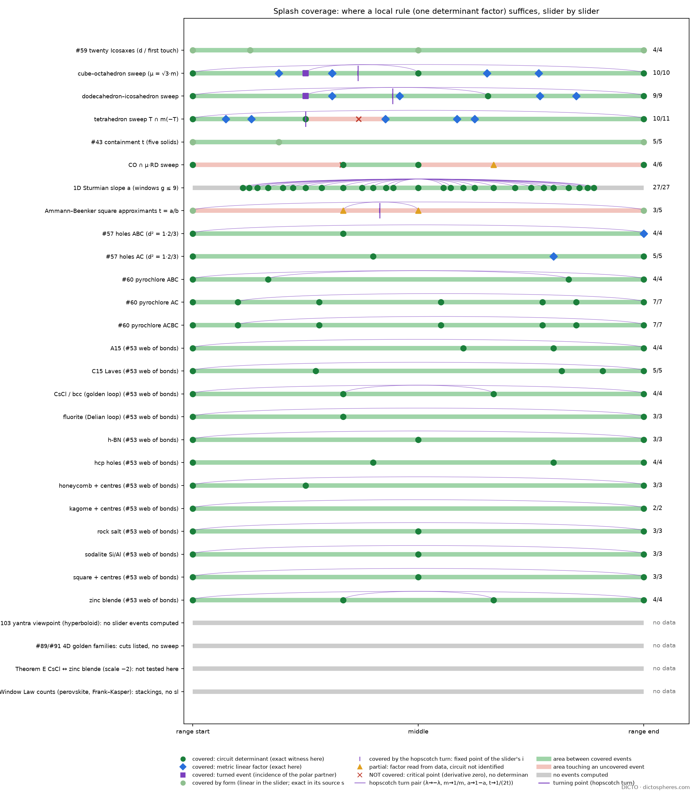
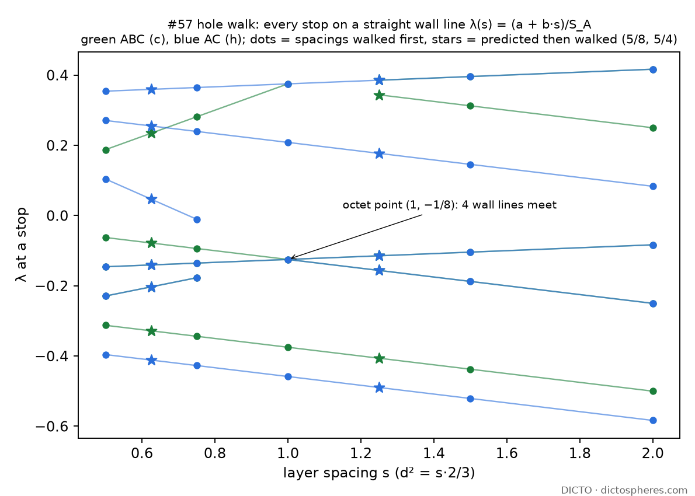

# Splash determinants: a coverage map of the slider events (2026-11-09)

**Conclusion.** Of 215 events computed exactly along DICTO's sliders, 194 are explained by one local rule, checked exactly here: a single determinant factor whose root is the event. In a further 16 the rule holds by the form of the event (11) or the event is the slider's turning point (5). 3 are only partly explained and 2 are not explained at all. Every weight-walk stop has one witnessing circuit, range ends included (136 of 136 with the perovskite walls). The golden cuts are **not** incidence determinants: each is the root of a linear edge-ratio factor.

**Status: DONE** (all scripts end `FINAL ok`). **Coverage:** weight sliders 138/138 (100%), slopes 30/32, scale sliders 42/45. **Hopscotch turn:** the turn exists on the three polar sweeps (m ↦ 1/m), on both approximant slopes, and on the walks whose kinds an isometry swaps (λ ↦ −λ). On the sweeps, the turned events showed up as predicted in 3 of 3 families. **Predictions tested:** 4 confirmed, 1 refuted (an algebra guess, corrected). **Not covered:** the Mahler maximum of the tetrahedron sweep and the Q4 zero of the CO ∩ μ·RD sweep. Both are critical or harmonic events, not determinant roots.

DICTO proposed reading the splash patterns for coverage: the areas where local rules suffice for now. DICTO proposed that at the end of the line one turns and comes back (the hopscotch turn). DICTO predicted the common denominator itself: one determinant per event, the Polar Line (`papers/polar-line-outline`). The Splash Rules method is DICTO's (27 Oct). Computation and drafting were done with Claude (Anthropic).

## 1. Method

- **Ledger first.** The Concordance ledger (53 entries) has no earlier attempt at events across families. The switch-theorem entry (8 Nov) covers interior flips of 12 networks, and only those are re-run here, as a regression. Everything else is new: range ends, pyrochlore, the #57 spacings, perovskite walls, sweeps and the turn.
- **Weight sliders (paraboloid).** `scripts/weight_events.py` handles every stop of an exact weight walk (#57's census engine, unchanged), both range ends included. It searches for a **witness**: d+2 sites whose lifted determinant c·(S₀ − λS_A) vanishes at the stop, is not identically zero, and has an empty closed power sphere. This is Theorem A of the switch-theorem study, tested on all stops. Floats only pick candidates; each witness is decided in Fractions. With two weights (perovskite) the determinant is S₀ − λS_A − μS_B, and its zero line must equal the wall line.
- **Walks covered.**
  - The 12 networks of #53 plus h-BN and sodalite.
  - #60 pyrochlore on ABC, AC (2H) and ACBC (4H).
  - The #57 hole walk on ABC and AC at layer spacings s = 1/2, 3/4, 1, 3/2, 2 (d² = s·2/3), then at s = 5/8 and 5/4 as a prediction test.
  - The perovskite chamber map: 11 wall segments on 7 lines.
- **Scale sliders (sphere).** `scripts/sweep_events.py` covers S(m) = P ∩ m·P* for the three dual families. P has inradius 1, the corner planes sit at distance m, and the arithmetic is exact sympy in Q(√2, √3, √5). On the cube–octahedron sweep, m = μ/√3 (#81). The script computes:
  - incidence events: four planes meeting on the boundary while the face lattice changes, from the 4×4 determinant affine in m;
  - the golden cuts of #88, rewritten as m values;
  - t_min, both from #43's definition and as max x·y over S × S^∨ (Proposition C of the octahedral-constant study);
  - the hopscotch turn m ↦ 1/m.

  `scripts/corrd_events.py` does the same for CO ∩ μ·RD, exactly in Q.
- **Turn and table.** `scripts/turn_checks.py` covers the turn on Ammann–Beenker and Sturmian approximants (data of splash2-approximants) and λ ↦ −λ on every walk. `scripts/aggregate.py` adds the events of earlier studies, checks each factor in sympy, and writes the table, the coverage, the s-family wall lines and both figures.
- **Where it ran.** All on dicto-big-brother (`~/geom/bin/python`), each run under 10 minutes.
- **Two slips caught and fixed in this study.** (1) The first icosahedron was set up in the orientation that is not dual to the dodecahedron (a 90° turn), which gave a false dodecahedral sweep. The fix: dual orientation, with the range now closed under m ↦ 1/m, which is checked. (2) One stop (AC at s = 2, λ = 5/12) first came back "no witness". The cause was the candidate budget, not the geometry. A float empty-sphere pre-filter is now standard, and the witness was then found (ttott, 7 sites).

## 2. Coverage map

Per family: covered / total, with strict (exact witness here) in brackets. Full table: `data/events.csv`, `data/events.json` (215 rows: event, exact value, slider, quadric, factor, status, source, turn partner).

| family (slider, quadric) | covered | uncovered or partial |
|---|---|---|
| 10 networks of #53 + 2 controls (weight λ, paraboloid) | 41/41 stops (41) | none |
| #57 holes ABC, AC at 7 spacings (weight λ) | 70/70 stops (70) | none |
| #60 pyrochlore ABC, AC, ACBC (weight λ) | 18/18 (18) | none |
| perovskite ABX3 walls (λ, μ) | 7/7 lines (11/11 segments) | none |
| Dehn zeros of the HexOct pieces on the #57 walk | 2/2 (metric) | none |
| cube–octahedron sweep (scale m, sphere) | 10/10 (9 + turning point) | none |
| dodecahedron–icosahedron sweep | 9/9 (8 + turning point) | none |
| tetrahedron sweep T ∩ m(−T) | 10/11 | Mahler maximum (11 − √33)/4: critical point |
| CO ∩ μ·RD sweep (three plane families) | 4/6 | Q4 zero 1 + √((6√30 − 31)/17), degree 4; Dehn zero 5/3 (factor not re-derived) |
| #43 containment t, five solids (scale t) | 5/5 by form | linear in t; not a derivation of the constants |
| #59 twenty Icosaxes (scale d) | 4/4 by form | affine in d; from #59's exact stops, not re-derived |
| 1D Sturmian slope a (cut-and-project) | 27/27 | none |
| Ammann–Beenker square approximants t | 3/5 | walls 2/3, 3/4: the factors 3a − 2b and 4a − 3b are read off the defect counts, but the lattice circuit is not identified |
| **no data on a slider** | none | #103 yantra viewpoint (hyperboloid); #89/#91 4D golden families; Theorem E (CsCl ↔ zinc blende, scale −2); Window-Law counts (stackings, no slider) |

**Areas.** On every weight slider, every interval between stops is bounded by covered events, so the whole range is covered (green). The tetrahedron sweep is pink only around its Mahler maximum. CO ∩ μ·RD is pink below 4/3, because of the Q4 zero, and above 3/2, because of the Dehn zero 5/3. The AB family is pink between its walls.

**Uncovered areas, cheapest first:**
1. **CO ∩ μ·RD Dehn zero 5/3.** Re-derive the Dehn coefficient on (3/2, 2) as a linear form in μ. Minutes, exact in Q.
2. **AB walls 2/3 and 3/4.** Find the period-lattice vector whose projection meets an edge of the acceptance octagon. Exact in Q(√2) with zono.py. About 1 hour.
3. **#59 stops and #43 containment.** Restate each as an explicit plane–vertex determinant. Cheap but nominal: they are already linear.
4. **Critical and harmonic events** (Mahler maximum, Q4 zeros). These need an extension of the framework, not a computation (section 6).
5. **The no-data rows.** The yantra viewpoint is the only quadric with no slider events at all, so it is the largest gap.

## 3. The event table (condensed; every row exact)

| event | value | slider / quadric | determinant factor (root) | source |
|---|---|---|---|---|
| fluorite (Delian) octet switch | −1/8 | λ / paraboloid | S₀ − λS_A = −1/8 − λ·1, circuit oct-tet-tet-tet-oct, RD cell (14) | #53 |
| fluorite range ends | −3/8, 3/8 | λ | −3/4 − 2λ; −3/8 + λ | #53 |
| hcp holes | −11/24 (end), −1/8, 5/24, 3/8 (end) | λ | (−11/48)/(1/2) at the low end, where the tet site is **not** in the hull of its nearest unlike sites (Theorem C's LP case) | #53 |
| CsCl, zinc blende | ±1 (flips), ±3 (ends) | λ | ±8/8; ±16/16; ∓24/8; ∓48/16 | #53 |
| A15, C15 | ±5/4, 1/4, 3/4; ±11, −5, 7, 9 | λ | e.g. (9/16)/(9/4) = 1/4; 240/(−48) = −5 | #53 |
| #60 pyrochlore 3C | ±3/8, ±1/4 | λ | e.g. (−1/48)/(1/12) = −1/4 (tetrahedra + truncated tetrahedra) | #60 |
| #60 pyrochlore 2H, 4H | −11/36, −1/4, −3/20, 0, 1/8, 1/6, 1/4 | λ | e.g. (−1/32)/(5/24) = −3/20 | #60 |
| #57 holes, any spacing s | ABC: −1/4 − s/8, −s/8, s/24 − 1/6, 5s/24 − 1/3, 3s/8, 1/3 + s/24, 1/2 − s/8; AC: −1/3 − s/8, −s/8, 1/3 − s/8, s/24 + 1/3, s/24 − 1/6, 5s/24 − 1/3, 1/3 − 11s/24 | (λ, s) / paraboloid | (S₀,lat + s·S₀,z)/S_A: one line per circuit | #57, Splash Rules |
| perovskite walls | λ = 0, λ + 2μ = 0, λ + μ = 1; boundaries λ = ±2, μ = ±1 | (λ, μ) | e.g. A-B-X-X-X circuit: 0 − λ·1 − μ·2 | #53 |
| CO sweep breaks | μ = 1, 2, 3 | m / sphere | 4-plane determinants 3m − √3, √3m − 2, m − √3 | #81 |
| CO sweep t_min kink | μ = 3/2 | m | the **turned** event: μ = 2 of S^∨ = S(3/μ) | octahedral-constant |
| CO sweep maximum of t_min | μ = √3, value 5 − 2√3 | m | none: the turning point; t_min(1) = R(S(1))² | octahedral-constant; here |
| dodeca–icosa breaks | m: roots of 45x⁴ − 30x² + 1 (0.79465), 9x⁴ − 15x² + 5 (1.09819), x⁴ − 30x² + 45 (1.25841) | m | 4-plane determinants, affine in m | here |
| dodeca–icosa t_min kink | 1/1.09819 = 0.91059 | m | turned event of S^∨ | here (prediction) |
| dodeca–icosa maximum of t_min | m = 1, value 1.174819, root of x⁴ − 40x³ + 530x² − 2480x + 2245 | m | turning point | here (prediction) |
| tetra sweep breaks | m = 1/3, 1, 3 | m | 3m − 1, m − 1, m − 3 | tetra-sweep |
| tetra sweep Dehn zero | 2 (and the turned 1/2) | m | 6a(μ − 2): metric, linear | tetra-sweep |
| tetra sweep Mahler maximum | (11 − √33)/4 (and its turn) | m | none: root of 2μ² − 11μ + 11 = f′ | tetra-sweep |
| golden cuts (#88), 10 | tetra 2√5 − 3, 1 + 2/√5 (turns (3 + 2√5)/11, 5 − 2√5); cube 1.330281, 1.462780 (min. poly 81x⁸ − 3024x⁶ + …); octahedron μ = φ, (5 − √5)/2; dodecahedron 1.151593, 1.189018; icosahedron 1.007353, 0.937962 | m | edge ratio − φ = 0: **linear metric factor**, not a plane determinant | #88 |
| Icosaxes Q4 zero | μ = φ | m | lies on the octahedron's golden-cut factor (x_G) | harmonic-fingerprint |
| CO ∩ μ·RD breaks | 1, 4/3, 3/2, 2 | μ / sphere | 4-plane determinants (exact, Q) | co-rd-sweep |
| CO ∩ μ·RD Q4 zero | 1 + √((6√30 − 31)/17) | μ | 17a⁴ + 62a² − 7 (a = μ − 1): degree 4, no factor | co-rd-sweep |
| HexOct Dehn zeros | λ = 5/24 (h pieces), 3/8 (c pieces) | λ | 36(5/24 − λ), 24(3/8 − λ): metric factors whose roots are circuit roots | ledger 4 Nov |
| Sturmian kinks | every Farey fraction p/q, q ≤ 9 | slope a / lattice line | p − q·a (the line through lattice point (q, p)) | splash2-approximants |
| AB walls | 2/3, 3/4 (ends 1/2, 1) | slope t / lattice plane | 3a − 2b, 4a − 3b (the defect counts are their squares) | splash2-approximants |

## 4. Rules found

1. **One stop, one circuit (weight sliders).** All 129 stops of 29 walks are roots S₀/S_A of one circuit with an empty power sphere, the 58 range ends included. So Theorem C's range ends are circuit roots too, even in its LP case: hcp holes −11/24, pyrochlore 2H −11/36, every #57 spacing. The witnessing dual cell has 4 to 24 sites.
2. **Straight walls in (λ, s).** At every layer spacing the stops of the #57 hole walk lie on 7 + 7 straight lines λ = (a + b·s)/S_A. Each line comes from one circuit (α does not depend on the metric, so S₀ is affine in s). The slopes are in {−11/24, −1/8, 1/24, 5/24, 3/8}, all multiples of 1/24. This is the (λ, s) counterpart of the perovskite's straight walls in (λ, μ).
3. **True close packing is a multiple point.** Four wall lines (−s/8, 1/3 − 11s/24, 5s/24 − 1/3, s/24 − 1/6) meet at **(s, λ) = (1, −1/8)**, the octet and fluorite switch with its RD dual cell. Three more meet at (1, 3/8), where #57's range end changes from 3s/8 to 1/3 + s/24. This is why s = 1 has the fewest windows and why its last window carries the 4 : 5 : 6 law.
4. **Field of an event = field of its factor.** Every weight event is rational: the denominators come from S_A, and at a rational s they divide 24 times the denominator of s (/64, /192 at s = 5/8). Every sweep incidence lies in the field of the plane normals: Q(√3) for the cube, degree 4 over Q for the dodecahedron. **Golden numbers enter only through metric factors** (edge ratios, Dehn coefficients), never through an incidence determinant. The one place φ looks like an incidence (Icosaxes at μ = φ) is the octahedron's golden cut, a metric factor.
5. **Two kinds of linear factor.**
   - *Incidence* (circuit or plane determinant): flips, range ends, face-lattice breaks, walls, Farey kinks.
   - *Metric* (lengths affine in the slider): golden cuts, Dehn zeros.

   Their roots coincide where a piece degenerates. The HexOct Dehn zeros 5/24 and 3/8 fall exactly on circuit roots, and the 4 : 5 : 6 volumes ∝ (3 − 8λ)³ vanish at the circuit root 3/8.
6. **No thirds, no new constant.** Every incidence factor seen is affine in its slider (degree 1). The only higher degrees come from critical points (Mahler, degree 2) and harmonics (Q4, degree 4).

## 5. The hopscotch turn (DICTO, 9 Nov)

DICTO proposed that at the end of the line one turns and comes back. Each slider family was tested for an involution of its slider.

| family | involution, turning point | what pairs | missing partners |
|---|---|---|---|
| polar sweeps S(m) = P ∩ mP* | m ↦ 1/m (S^∨ = S(1/m)), turning point m = 1 (equal plane distances; μ = √3 on #81's sweep) | the range ends always pair; the tetrahedron sweep (self-dual) pairs everything, golden cuts included | cube: μ = 2 ↔ 3/2; dodecahedron: 1.09819 ↔ 0.91059. The missing partner **is an event of the polar body S^∨**, and it shows up as a kink of t_min, which reads S and S^∨ together (confirmed, 3 of 3 families). Golden cuts do not pair (metric, not polar) except on the self-dual tetrahedron |
| weight walks | λ ↦ −λ (kind swap), turning point λ = 0 | all stops when an isometry swaps the kinds: square, rock salt, CsCl, zinc blende, h-BN, sodalite, pyrochlore 3C (atoms and holes swap roles, #60); kagome pairs only because its two stops are its ends | interior flips of the other nets (fluorite −1/8, hcp holes, A15, C15, honeycomb, pyrochlore 2H/4H, #57 at s ≠ 1). The walks are complete, so these partners are **refuted**, not predicted. The ends pair exactly when both kinds lie in the hull of their nearest unlike sites: then the ends are ∓d² with the same d (Theorem C) |
| Sturmian slope a | a ↦ 1 − a (S ↔ L), turning point 1/2 | all Farey kinks, every window | none |
| AB square approximants t | t ↦ 1/(2t), turning point the quasicrystal 1/√2 | walls 2/3 ↔ 3/4, ends 1/2 ↔ 1 | none; and **every star frequency is kept** (34 of 34 pairs in the data): the turned approximant is the same tiling turned by 45° |
| CO ∩ μ·RD | none (its polar is not in the family) | none | none |

**The turning point is extremal.** t_min is largest at the turning point in all three sweeps, with t_min(1) = R(S(1))², because S^∨ = S there. The isoperimetric quotient of the tetrahedron sweep is largest there too. The Mahler volume is a local *minimum* there (32/3), with its two maxima a turn pair. So "fixed point = maximum" holds for t_min but not for every invariant.

## 6. Verdict on the Polar Line table

- **#53 Theorems A–C (paraboloid): VERIFIED and extended.** One circuit per stop on 29 walks, ends included, plus two weights (all 7 perovskite lines are S₀ − λS_A − μS_B = 0, which settles switch-theorem LEAD 3).
- **#81 core turn (sphere): VERIFIED and extended** to the tetrahedron and dodecahedron–icosahedron sweeps (the maximum of t_min sits at the turning point, with value R(S(1))²). The cube sweep's 3/2 is now explained: the turned partner of the break 2.
- **#88–#91 golden cuts: the outline's wording is WRONG as stated.** The cuts are not "roots of the face-plane determinants". They are roots of linear edge-ratio factors (metric), in Q(φ, cos π/n, normals), up to degree 8 for the cube. The sweep form S(m) = P ∩ mP* holds; the factor type must change in the outline.
- **#43 containment (sphere): fits only by form.** The containment event is linear in t, but that does not derive the constants 9, 3, 15 − 6√5. Not verified as a derivation.
- **#57 Rule of Halves / Swap Rule (paraboloid): the window ends are verified** as circuit lines in (λ, s), with the multiple point at (1, −1/8). The halves themselves (volume laws) are not events, so not tested here.
- **Theorem E and #103 yantra (hyperboloid): no data.** Not tested.
- **Prediction "event degree bounded by the determinant's field": CONFIRMED** on every incidence and metric event.
- **Prediction "the fixed point maximises the containment constant": CONFIRMED** on 3 of 3 sweeps (new: tetrahedron, value 3; dodecahedron–icosahedron, value 1.174819…).

**Where the framework must be extended:** the events that are not determinant roots.
- **Critical points:** Mahler maxima; the maximum of t_min, which is however explained by the turn.
- **Harmonic zeros:** Q4 on CO ∩ μ·RD, degree 4.
- **Metric factors:** golden cuts, Dehn zeros. These are linear and exact, but they come from lengths, not from incidences of the quadric.

A complete Polar Line needs three event types: incidence (determinant), metric (length factor) and stationary (derivative or turn).

## 7. Predictions

| prediction | status |
|---|---|
| Every stop of the #57 hole walk at a new spacing lies on a wall line from s ∈ {1/2, 3/4, 1, 3/2, 2} | **CONFIRMED** at s = 5/8 (11 of 11 stops) and 5/4 (10 of 10); the bracket rule predicted 17 stops exactly, 17 of 17 hit |
| The t_min kinks of a polar sweep are the events of S and their turns | **CONFIRMED** 3 of 3 (cube 0.8660, 1.1547; dodecahedron 0.9106, 1.0982; tetrahedron 1) |
| t_min is largest at the turning point, value R(S(1))² | **CONFIRMED** 3 of 3 |
| AB: t ↦ 1/(2t) keeps every star frequency | **CONFIRMED** 34 of 34 |
| AB: the turn doubles the vertex count (my algebra guess) | **REFUTED**: the count is equal (ratio 1). The turn is a 45° rotation of the same tiling |
| Untested: on CO ∩ μ·RD a Dehn factor linear in μ, root 5/3 exactly | cheap; open |
| Untested: AB's larger windows have walls in pairs p/q ↔ q/(2p) around 1/√2 (Pell 5/7 ↔ 7/10, 12/17 ↔ 17/24) | open |
| Untested: on the #57 (λ, s) plane, new walls appear only at crossings of existing lines (e.g. 1/2 − s/8 and 1/3 + s/24 are born at s = 1) | open, cheap: walk s = 9/8 |

## 8. LEADS

1. **Polar Line outline:** correct the #88–#91 row (metric factor, not a plane determinant) and add the three event types. DICTO decides the wording.
2. **The octet multiple point (1, −1/8)** belongs with #57 or #61 as a corollary: "true close packing is where four walls of the hole walk meet". Where to place it: one-line question to DICTO.
3. **dodecahedron–icosahedron t_min = 1.174819** (quartic x⁴ − 40x³ + 530x² − 2480x + 2245) at the equal-inradius member: the icosahedral counterpart of 5 − 2√3. It belongs beside the octahedral-constant results.
4. **The AB walls as a lattice incidence** (cheapest open area), and the Pell-pair prediction for larger windows.
5. **The yantra (hyperboloid) has no slider data.** One sweep of the viewpoint with the same event finder would open the third quadric.
6. **The weight-walk turn criterion** (ends pair iff both kinds are in the hull of their nearest unlike sites) is a corollary of Theorem C. It could be added to the switch-theorem material.

## 9. Checks

| script | result |
|---|---|
| weight_events.py relay (12 nets, two runs), pyro, sfam (7 spacings), perov | 41/41, 18/18, 70/70, 11/11 segments; census check failures in new walks 0; FINAL ok each |
| sweep_events.py | 12/12 PASS (range closed under the turn, kinks = events ∪ turned events, t_min by definition = bilinear form and turn-invariant, maximum at the turning point), FINAL ok |
| corrd_events.py | 4-plane roots with a face-lattice change = {1, 4/3, 3/2, 2}, FINAL ok |
| turn_checks.py | 4/4 PASS, FINAL ok |
| aggregate.py | 9/9 PASS (sympy factor checks, 4 prediction tests, concurrency), FINAL ok |

**Sources checked:**
- Concordance `concordance.json` (ledger, 53 entries; papers #43, #53, #57, #59, #60, #81, #88–#91, #103 entries).
- Polar Line outline.
- Study READMEs: switch-theorem, octahedral-constant, splash-rules (with PROOF.md summary), halves-physics, splash2-frank-kasper, splash2-approximants (ab.json, sturm.log, ablaw.log, abfam.log), splash2-perovskite, relay-census (raw walks, perovskite chamber data), pyrochlore-halves (pyro-walk-exact.json), rule-of-halves-census, icosaxes-twenty, golden-cuts-beyond-plato, co-rd-sweep, tetra-sweep, nesting-proof.
- No new outside literature was searched. Every claim here is an exact check of in-house data; prior art is that of the source studies (Edelsbrunner–Shah and GKZ for the lifted determinant; Morse–Hedlund and Berthé for Farey kinks; the octahedral-constant study for Proposition C).

## 10. Ledger line (for the Concordance; not entered by this study)

`{"question": "Splash coverage: does one determinant factor explain each slider event (Polar Line), and does each slider have a hopscotch turn?", "method": "weight_events.py (exact circuit witness per stop, 29 walks + perovskite walls), sweep_events.py / corrd_events.py (4-plane determinants, golden cuts, t_min, turn m->1/m), turn_checks.py, aggregate.py", "status": "SETTLED (coverage) / OPEN (critical + harmonic events, AB walls, yantra)", "result": "215 events: 194 one exact factor, 210 covered incl. form/turning point, 3 partial, 2 not (Mahler max, CO∩RD Q4); all 129 walk stops incl. 58 range ends are circuit roots; #57 walls straight in (lam, s), 4 meet at (1, -1/8); golden cuts are metric (edge-ratio) factors, not plane determinants; turn m->1/m: missing partners are S^dual events = t_min kinks (3/3), t_min max at turning point = R(S(1))^2 (3/3); AB turn t->1/(2t) keeps all star frequencies (34/34)", "retry": "only: AB wall circuit, CO∩RD Dehn 5/3, yantra slider", "study": "2026-11-09-splash-determinants", "date": "2026-11-09"}`

## Files

- `scripts/`: weight_events.py, sweep_events.py, corrd_events.py, turn_checks.py, aggregate.py.
- `data/`: events.csv and events.json (the table), coverage.json, sfam-lines.json, sfam-concurrency.json, sweep-events.json and .log, corrd-events.json, turn-checks.json and .log, weight-*.json and .log (one per run), aggregate.log, walks/ (cached exact walks).
- `figures/`: splash-coverage.png (the coverage map with turn arcs and turning points), s-lambda.png (the wall lines of the #57 hole walk).

DICTO · dictospheres.com
