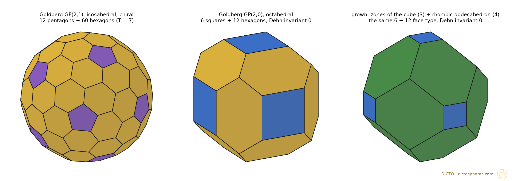
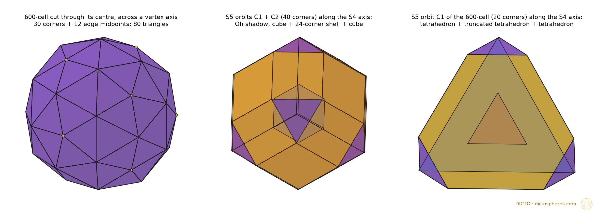

# Echo shapes: classic symmetries with multiplied face counts (15 Nov 2026)

**Verdict (15 Nov 2026).** DICTO, 15 Nov 2026: "we may be looking for shapes that echo classic symmetries but multiply face counts", in all three readings. All three were run in exact arithmetic, with the law-giving tests and the space-filling tests applied to every shape found. There were 105 subdivisions, 13 shadow and section families and 26 zonohedra, plus 46,673 (k = 12) and 458,161 (k = 14) grown surfaces, with 0 failed checks.

1. **One face pattern turns up in all three readings.** It is the Goldberg pattern GP(2,0): 12 pentagons and 30 hexagons, with dual 42 corners and 80 triangles.
   - In reading A it is the (2,0) subdivision of the icosahedron.
   - In reading B it appears twice:
     - The 600-cell cut through its centre across a vertex axis gives 42 corners and 80 triangles. This cut coincides with the 600-cell's shadow along the same axis.
     - The 120-cell cut across a cell-centre axis gives 12 pentagons and 30 hexagons.
   - The two cuts are polar to each other, because a central section of a polytope is polar to the shadow of its polar.
   - The octahedral partner of this pattern behaves the same way. GP(2,0) of the octahedron (the chamfered-cube type, 6 squares and 12 hexagons) is also the zonohedron grown from the cube's 3 zones plus the rhombic dodecahedron's 4 zones (reading C).
   - **Both realisations have Dehn invariant 0.** In the Goldberg form every dihedral angle is 120° or 135°.
   - **Neither tiles by translation.** It has 18 faces and belts of 8. Whether it tiles space in some other way is open.
2. **No new law-giving point.** Every tone zero in all 144 echoes is forced by symmetry.
   - Most are forced by the image's own group, through its Molien count.
   - Every echo except one has no unforced zero.
   - The exception is the tetrahedral (1,1) subdivision. Read on the sphere, its points are the cube's 8 corners, so a hidden octahedral symmetry forces its extra zeros. That is a symmetry raised by projection to the sphere, an echo of the law-giving census's (X) kind.
   - The lowest free tone never changes sign across the 35 subdivisions of any of the three bases, so it has no crossing.
   - **The chirality tone T₁₅ is the one systematic law found.** It is zero exactly when the subdivision is mirror-symmetric (k = 0 or k = h), because central symmetry forces it. In the icosahedral chiral members it is nonzero and dies away fast: 8.8·10⁻², 2.2·10⁻⁴ and 3·10⁻⁷ at (2,1), (3,1) and (4,3).
3. **Shadows multiply counts by coincidence, and symmetry rises.**
   - Along a vertex axis, the 600-cell's 120 corners land on 75 points, 45 of them doubled (among them the centre, which carries both poles).
   - The E8 roots' H4 shadow (two 600-cells, sizes 1 and 1/φ) puts a **fourfold icosahedron** at radius sin 36° = cos 18°/φ, where the two 600-cells' icosahedral layers fall on the same points (an exact golden identity).
   - Every cell-first or vertex-first shadow of a tetrahedrally stabilised direction gains the central inversion (T_d becomes O_h).
   - The 5-cell orbit C1 of the 600-cell (20 corners) casts a tetrahedron, a truncated tetrahedron and a tetrahedron.
   - C1 together with its antipode C2 casts cube, 24-corner shell and cube.
   - The orbit's 4D silence in degree 7, forced by integrality (golden A4 study), does **not** survive the shadow (T₇ ≈ 0.0038). Only the T_d silences 1, 2 and 5 remain.
4. **Grown echoes (gnomon = add whole zones).** The golden ladder ends at the triacontahedron, and that end is proved, not observed.
   - **Theorem:** a rhombic monohedral polyhedron in which every two zones cross has its edge directions pairwise equiangular. So it has at most 6 directions, since 6 is the most equiangular lines R³ can hold (Lemmens–Seidel 1973). Hence k = 2(n − 1) ≤ 10, and at k = 10 the rhombus is the golden one.
   - So Grünbaum's question at k ≥ 12 needs parallel zones (two zones on one axis) or zones crossing other than twice.
   - We grew GET A, GET B and candidate 2 with the gnomon along existing axes (parallel zone layers). Exactly, with no cap, **no surface with every zone of 12 faces arises in up to 3 layers.** This takes 46,673 grown surfaces, 42,805 of them valid spheres.
   - The forced two-layer case is empty for a structural reason: no closed path of the forced shape exists on any one-layer surface.
   - k = 14 in up to 2 layers: 450,172 surfaces have every zone of 14 faces, but all of them have adjacent coplanar faces, so none meets Grünbaum's rule (exact, uncapped).
   - Novelty: the GP(2,0) appearances as central sections of the 600-cell and 120-cell, and the Dehn-zero chamfered-cube pair, were not found in the sources checked (below). They are **provisional**: Coxeter's *Regular Polytopes* tables of sections were not re-read for this study.

Computation, proofs and drafting were done with Claude (Anthropic). All exact arithmetic is in ℚ(√5), as a + bφ with rational a and b, or ℤ[φ] for the surfaces. The Dehn tests use PSLQ at 80 digits, like the census for H3: "nonzero" means no relation with coefficients ≤ 10⁶ was found.

*Figure 1: Goldberg GP(2,1) (chiral, 12 + 60), GP(2,0) of the octahedron (6 + 12; Dehn 0), and the same 6 + 12 type grown as the zonohedron of the cube and rhombic dodecahedron zones. The same image is in the reading folder as RENDER-echoes-solids.png.*

*Figure 2: the 600-cell's central cut across a vertex axis (30 corners of the icosidodecahedron + 12 raised edge midpoints, gold dots), the 40 corners C1 + C2 along the S4 axis (O_h), and C1 alone (T_d). The same image is in the reading folder as RENDER-echoes-shadows.png.*

## Table of echoes (selected; every row is in `data/*.json`)

Counts are V/E/F. "Tiles?" means tiling by translation, decided exactly for convex solids (Venkov–McMullen). "Dehn" means: 0 means that other tilings are not excluded, ≠0 means no tiling at all (Debrunner 1980). "Silences" means tone zeros, with whether symmetry forces them. Names are combinatorial types unless the solid is uniform.

| family | echo | counts V/E/F | symmetry | tiles? (Dehn) | silences | known/new |
|---|---|---|---|---|---|---|
| A icosahedral | geodesic (h,k), Goldberg GP(h,k) | 10T+2 points; GP faces 12 + 10(T−1) | I_h (k=0, h=k), I (chiral) | no (≠0) for every T ≤ 13 | all forced (I_h / I); T₁₅ ≠ 0 exactly for chiral | known (Goldberg 1937, Caspar–Klug 1962, Coxeter 1971) |
| A octahedral | GP(1,1) | 24/36/14 | O_h | no (≠0) as a polar; the Kelvin form tiles | forced | known; this proportion is not Kelvin's |
| A octahedral | **GP(2,0), polar form** | 32/48/18 (6 □ + 12 hexagons) | O_h | no translation; **Dehn 0** (angles 120°, 135°) | forced | chamfered cube known; Dehn-0 note not found in sources |
| A tetrahedral | (1,1) on the sphere | 8 points = cube | T_d raised to O_h | cube tiles | 3, 7, 9 … unforced by T_d, forced by hidden O_h | known coincidence |
| A tetrahedral | GP(h,k) | 2T+2 points, 4 triangles + 2(T−1) hexagons | T_d / T | no (≠0) | forced | known |
| B 600-cell, vertex axis | shadow | 120 → 75 points: centre ×2, 12×2, 20×2, 12×2, 30 | I_h | shells ≠0 | forced | known (Coxeter) |
| B 600-cell, vertex axis | **central cut** = shadow hull | 42/120/80 (GP(2,0) dual type; 30 at r = 1, 12 at r = 0.951) | I_h | no (≠0) | forced | **not found in sources** (the vertex slice alone, the icosidodecahedron, is known: Baez 2023) |
| B 120-cell, cell axis | **central cut** | 80/120/42 (12 pentagons + 30 hexagons) | I_h | no (≠0) | forced | **not found in sources**; polar to the row above |
| B 120-cell, cell axis | shadow | 600 → 330 points (270 doubled): dodecahedra, icosidodecahedron, truncated icosahedra, rhombicosidodecahedra | I_h | shells ≠0 | forced | shells known |
| B 120-cell, vertex axis | shadow / cut | 519 points, 15 shells; cut 78/120/44 (24 pentagons + 20 hexagons) | O_h (T_d + inversion) | no (≠0) | forced | not found |
| B 600-cell, cell axis | shadow / cut | 114 points, 8 shells (3 cubes, octahedron×2, …); cut 84/240/158 (152 △ + 6 □) | O_h | cube shells tile | forced | not found |
| B 24-cell | vertex-axis cut | rhombic dodecahedron | O_h | **yes** (Dehn 0) | forced | known |
| B E8 → H4 shadow | vertex axis | 240 → 137 points; **icosahedron ×4** at r = sin 36° | I_h | shells ≠0 | forced | the coincidence is not found stated |
| B S5 orbit C1 (20) | S4 axis | 4 + 12 + 4: tetrahedron, truncated tetrahedron, tetrahedron | T_d | no | 1, 2, 5 forced; 4D T₇ = 0 lost | new reading of a known orbit |
| B S5 orbits C1 + C2 (40) | S4 axis | 8 + 24 + 8: cube, 24-shell, cube | O_h | cube shells tile | forced | new reading |
| B S5 orbit C3 (20) | S4 axis | 8 + 12: cube + cuboctahedron | O_h | cube tiles | forced | new reading |
| B S5 orbits C4 (30), C4 + C5 (60) | S4 axis | 6 + 12 + 12; 6×2 + 24 + 24 | T_d; O_h | no | forced | new reading |
| C golden ladder | 3 → 4 → 5 → 6 of the 5-fold axes | 6 → 12 → 20 → 30 rhombi; zones 4, 6, 8, 10 | D3d, D2h, D5d, I_h | yes, yes, no, no | forced | known (Bilinski; Hart 1999) |
| C I_h trees | A5, A3, A2 and unions | 30, 90 (enneacontahedron), 62 (truncated icosidodecahedron), 90, 122, 182, 242 faces | I_h | no (zones > 6); Dehn 0 | forced | known (Hart 1999) |
| C O_h trees | C4, C3, C2 and unions | 6, 12, 14 (tilers), 18 (= GP(2,0)), 26, 50, 50 | O_h | first three yes; rest no; Dehn 0 | forced | known |
| C beyond GET | parallel zone layers, k = 12 | 0 surfaces in ≤ 3 layers | — | — | — | new negative result (exact, uncapped) |
| C beyond GET | parallel zone layers, k = 14 | 450,172 zone-uniform surfaces in ≤ 2 layers, all with coplanar adjacent faces | — | — | — | new negative result for Grünbaum's rule (exact, uncapped) |

## A. Subdivided echoes (`scripts/gc_echoes.py`, `data/gc.json`)

**Construction.**
- The Goldberg–Coxeter (h,k) triangle (corners 0, (h,k) and its 60° turn in the triangular lattice) is laid on every face of the icosahedron, octahedron and tetrahedron. The face corners are in ℚ(√5).
- Every lattice point maps flat with exact barycentric coordinates, with denominator T = h² + hk + k².
- The points are then read as directions. The **geodesic polyhedron** is the hull of these unit directions. The **Goldberg polyhedron** is its polar, with faces tangent to the unit sphere at the geodesic points.
- All 35 pairs with 1 ≤ h ≤ 7 and 0 ≤ k ≤ h were run on each base, 105 in all. Solids were built for T ≤ 13.

**Checks, all ok:**
- the point counts 10T+2, 4T+2 and 2T+2;
- the computed symmetry group (I_h or I, O_h or O, T_d or T), chiral exactly for class III;
- every forced silence is zero;
- the hull is always the Goldberg–Coxeter triangulation (20T, 8T or 4T triangles). The one exception is tetrahedral (1,1), whose points are the cube's.

**Tones.**
- Forced silences come from the Molien count of the group:
  - I_h (to degree 30): 1–5, 7–9, 11, 13, 14 and every odd degree;
  - I: 1–5, 7–9, 11, 13, 14, 17, 19, 23, 29 (15, 21, 25 and 27 are allowed);
  - O_h: 2 and every odd degree; O: 1, 2, 3, 5, 7, 11;
  - T_d and T: 1, 2, 5.
- No unforced zero occurs anywhere, except tetrahedral (1,1). There T₃, T₇, T₉, … vanish because the 8 points are the cube's corners.
- The signed amplitude of the lowest invariant tone has one sign through all 35 members of each base: A₆ for the icosahedron, A₄ for the octahedron, A₃ for the tetrahedron. It is computed as Σ over points and base corners of P_k(x·a). So no crossing happens and nothing is law-giving.
- The chirality tone T₁₅ is forced to 0 by mirror symmetry and is otherwise nonzero:
  - icosahedral (2,1): 0.088, then (3,1): 2.2·10⁻⁴, …, (4,3): 3·10⁻⁷;
  - octahedral and tetrahedral chiral members: 10⁻³ to 10⁻¹.

**Space filling, for T ≤ 13:**
- Every geodesic polyhedron has Dehn ≠ 0, so it does not tile, except tetrahedral (1,1), whose hull is the cube.
- Every Goldberg polar has Dehn ≠ 0 except two: the cube (octahedral (1,0)) and the **octahedral GP(2,0)**.
- The polar GP(2,0) is the cube [−1,1]³ cut by the 12 planes |x| + |y| ≤ √2. Its dihedral angles are exactly 135° (square–hexagon) and 120° (hexagon–hexagon), so the Dehn invariant is 0 exactly.
- It is not a parallelohedron: it has 18 faces, belts of 6 and 8, and every face is centrally symmetric. Whether it tiles space with rotations is **open**.
- The octahedral GP(1,1) as a polar has μ = √3, not 3/2, so it is not Kelvin's cell and has Dehn ≠ 0. The combinatorial type does tile in Kelvin's proportion (census row 11).

**Rhombic/zonohedral forms.** For any 4-valent map, the GC_{k,0} construction multiplies central circuits by k. The duals are then subdivided zonohedra, flat (coplanar) rhombi, and give no new solid. GC_{1,1} of the cuboctahedron and of the icosidodecahedron give the Catalan kite solids (deltoidal icositetrahedron and deltoidal hexecontahedron), which are known. The genuine zonohedral echoes are the grown ones in C.

## B. Shadow echoes (`scripts/shadow_echoes.py`, `data/shadow.json`)

**Sets:**
- the 24-cell (24 corners);
- the 600-cell (120 corners, 720 edges, 600 facets);
- the 120-cell (600 corners, 1200 edges, 120 facets);
- the E8 roots' H4 shadow: the 600-cell together with the 600-cell scaled by 1/φ (Elser–Sloane 1987; Moody–Patera 1993; ledger [183]);
- the five S5-orbits of the 600-cell, of sizes 20, 20, 20, 30 and 30. C3 was found exactly as the remainder of the closure of C1.

**Method.**
- **Axes:** every corner direction and every facet-centre direction, deduplicated by the image's shell signature. For the S5-orbits, the axis is the S4-fixed one, (1,1,1,1,−4).
- **Exactness:** images are exact via ⟨Px, Py⟩ = ⟨x, y⟩ − (x·d)(y·d)/(d·d).
- **Section of the solid:** the corners on the hyperplane plus the exact edge crossings.

**Findings:**
- **600-cell, vertex axis.**
  - The solid cut is not the icosidodecahedron. The 30 equatorial corners (the vertex slice, Coxeter; Baez 2023) are joined by the 12 midpoints of the edges that link the two icosahedral layers at heights ±1/(2φ). Each such edge joins (±1/(2φ), v), so it is cut at (0, v), with |v| = cos 18° ≈ 0.951.
  - These sit above the pentagon faces, whose distance is 0.851, giving 42 corners and 80 triangles: the dual GP(2,0) type.
  - The same 42 points bound the shadow, so the 600-cell's central cut and its shadow along a vertex axis are the same solid.
- **120-cell, cell axis.** By polarity ((P ∩ H)* = π_H(P*)), the 120-cell's central cut is the polar of that solid: 12 pentagons and 30 hexagons (GP(2,0) type), computed directly.
- **Coincidence counts:**
  - 600-cell along a vertex axis: 45 of 75 image points are doubled;
  - 120-cell along a cell axis: 270 of 330;
  - E8 shadow: 77 of 137, including a **fourfold icosahedron**.
- **Symmetry raised:** facet-axis shadows of the 600-cell and vertex-axis shadows of the 120-cell have O_h symmetry. The stabiliser is T_d, and the central inversion of the 4D set is added.
- **Tones:** zero unforced zeros in all 13 images and 6 cuts.
- **Dehn and tiling:** every shell hull and every cut has Dehn ≠ 0, except:
  - the cube shells;
  - the 24-cell's vertex-axis cut, which is the rhombic dodecahedron and tiles.

## C. Grown echoes (`scripts/zono_growth.py`, `scripts/gnomon12.py`; `data/zono.json`, `data/g12.json`)

**Zonohedra.**
- The gnomon for a zonohedron adds one whole zone, which is a Minkowski sum with a segment. Keeping the symmetry means adding a whole orbit of zones.
- **I_h growth tree:**
  - A5 (6 axes): triacontahedron, 30 rhombi;
  - A3 (10): rhombic enneacontahedron, 90 rhombi of 2 shapes;
  - A2 (15): truncated icosidodecahedron type, 30 + 20 + 12;
  - A5 + A3: 60 rhombi + 30 octagons;
  - A5 + A2: 122 faces;
  - A3 + A2: 182 faces;
  - all 31: 242 faces (Hart 1999).
- **O_h growth tree:**
  - cube 6, rhombic dodecahedron 12, truncated octahedron 14 (the three tilers);
  - cube + RD zones: 18 faces (= GP(2,0) of the octahedron);
  - cube + diagonals: the truncated cuboctahedron, 26 faces;
  - two 50-face members.
- **Golden ladder, by subsets of the 5-fold axes:** rhombohedra (two classes) → Bilinski dodecahedron → rhombic icosahedron → triacontahedron.
- **Every zonohedron:**
  - has Dehn 0 (it is a union of parallelepipeds; checked numerically as a control);
  - tiles by translation exactly when all its zones have 4 or 6 faces (the Venkov test on the hull agrees);
  - has only forced tone zeros (no unforced zero).
- **Theorem (equiangular ladder).** In a rhombic monohedral polyhedron every face is congruent. So the two edge directions of every face meet at one angle up to its supplement. If every two zones cross (class C(n) of the GET study), all pairs of the n directions are such face pairs. They then form n equiangular lines, so n ≤ 6 (Lemmens–Seidel 1973). The six-line configuration in R³ is the icosahedron's diagonals, at cos = 1/√5, so at n = 6 the rhombus is golden. **So k = 2(n − 1) ≤ 10 in class C(n): GET's k = 10 is the top of the ladder, and the golden rhombus there is forced.**

**Beyond GET (k = 12).**
- **The move.** No seventh golden direction exists, so a new zone must run parallel to an existing axis a. We cut along a closed edge path avoiding a, shift one side by e_a, and close the cut with a band of rhombi (d, a). The zone of direction d gains one face for each path edge lying in it.
- **Counting lemma (proved).** Start from six zones of 10 and add m parallel zones with paths P₁ … P_m. All zones end with k faces only if Σ|P_i| = 3(k − 10) + mk/2.
  - For k = 12, m = 1 is impossible: the zone parallel to the new one would need edges of its own direction.
  - m = 2 forces |P₁| = 6 (two edges in each of three directions, all ≠ a). It also forces P₂ (along b) to have 12 edges: 6 rungs of the new band, 2 old a-edges, and 2 each of the last two directions.
- **Exhaustive results (exact):**
  - **Forced case (m = 2), from GET A, GET B and candidate 2:** 1,962 first paths gave 2,019 valid one-layer surfaces. On none of them does a closed path with the forced direction counts exist. Even the relaxed counts (a⁴ e² f², a⁶ e² f²) have none.
  - **General search, m ≤ 3, every zone ≤ 12, uncapped:** 40,052 paths and 42,805 valid surfaces, **no surface with all zones of 12**.
  - **Control:** the triacontahedron plus one parallel zone gives exactly the predicted profile (10, 10, 12 × 5) in all 244 results.
- **k = 14, m ≤ 2 (exact, uncapped, 18 min):**
  - 458,161 grown surfaces, all closed oriented spheres.
  - 450,172 have every zone of exactly 14 faces, and in all of them the faces of each pair type balance in outward sides.
  - **None of them obeys Grünbaum's rule.** Every one has two adjacent coplanar faces. So no sphere-like k = 14 answer arises in two parallel layers from GET.
  - Why the parallel band always lies flat against a face of its own plane is not proved; it is a lead.
- **Scope.** The move set requires every intermediate surface to be a closed oriented sphere. Embedding is tested only at hits (a necessary test), so "no hit" is safe. Larger m, other starting surfaces, and zones that cross four times are not covered.

## Prior art and sources checked

| Source | Read | Bearing |
|---|---|---|
| Dutour & Deza, "Goldberg–Coxeter construction for 3- and 4-valent plane graphs", Electron. J. Combin. 11 (2004) R20 | abstract page (combinatorics.org) | the GC_{k,l} construction; credits Goldberg 1937 and Coxeter 1971; central circuits and zigzags |
| Goldberg, Tôhoku Math. J. 43 (1937) 104–108; Caspar & Klug, Cold Spring Harbor Symp. 27 (1962) 1–24; Coxeter, "Virus macromolecules and geodesic domes" (1971) | cited through Dutour–Deza and Schein–Gayed; not read | the T = h² + hk + k² construction |
| Schein & Gayed, PNAS 111 (2014) 2920–2925 | abstract and news reports (phys.org, Science News) | planar-faced equilateral Goldberg polyhedra; nothing on Dehn or tiling |
| G. W. Hart, "Zonohedrification", Mathematica J. 7(3) (1999) | full page (georgehart.com) | triacontahedron, enneacontahedron, truncated icosidodecahedron, 31-zone 242-face solid |
| Baez, arXiv:2309.15774 | search excerpt | icosidodecahedron as the equatorial vertex slice of the 600-cell |
| Wikipedia, 600-cell (mirror) and Equiangular lines | page | vertex-first shells; 6 equiangular lines in R³ (icosahedron) |
| Lemmens & Seidel, "Equiangular lines", J. Algebra 24 (1973) | cited through Wikipedia; not read | maximum 6 in R³ |
| Koca, Ozdes Koca & Al-Ajmi, Turk. J. Phys. 36 (2012) | through the golden A4 study | S5-orbits 20+20+20+30+30 |
| Elser & Sloane 1987; Moody & Patera 1993 | through ledger [183] | E8 to H4: two 600-cells |
| Grünbaum 2010 and the GET study | earlier study | k-ladder; class C(n) |
| Venkov 1954, McMullen 1980 (parallelohedra); Debrunner 1980 (Dehn 0 for tiles) | standard, cited | the tiling tests |

**Web searches:**
- "Goldberg polyhedra geodesic spherical t-design icosahedral orbits harmonic invariants": nothing on tones or designs of GC sets;
- "Deza Dutour Goldberg-Coxeter construction";
- "Schein Gayed fourth class convex equilateral polyhedron";
- "600-cell projection 3D vertex-first cell-first shells icosidodecahedron compound sections Coxeter".

No paid source was used. **Not read:** Coxeter, *Regular Polytopes*, Table V (sections of {3,3,5} and {5,3,3}). It must be checked before any novelty claim on the two GP(2,0) cuts.

## Runs

All runs ended FINAL ok, and nothing was left running.

| run | what | time |
|---|---|---|
| `echo-gc` | part A | 6 min |
| `echo-shadow` | part B | 1.5 min |
| `echo-zono` | part C, zonohedra | 36 s |
| `echo-g12` | part C, growth beyond GET: k = 12 (uncapped, 125 s) and a first k = 14 pass (capped at 3000 s; its unfiltered 2.6 GB output was deleted, counts kept in the log) | 52 min |
| `echo-g14` | part C, k = 14 with filters | 18 min |
| `echo-render` | figures | |

Pilots (≤ 5 min) came first, and each found or fixed something:
- The part B pilot caught a wrong control: the solid cut is 42 points, not 30.
- The part C pilot added the path diagnostics.

**Leads:**
- (1) Read Coxeter's Table V for the two GP(2,0) cuts.
- (2) Does the Dehn-zero octahedral GP(2,0) (cube ∩ {|x| + |y| ≤ √2}) tile space with rotations? A corona search is the next method.
- (3) k = 12 with m ≥ 4 layers, or zones crossing four times. Next method: a SAT formulation of zone words with parallel zones.
- (4) Why every zone-uniform k = 14 surface grown by parallel layers has a band face lying flat against a neighbour (a lemma would close m = 2 for every k).
- (5) Other central cuts of the 120-cell and 600-cell at golden heights. These are exact; ledger [21] had only a grid.
