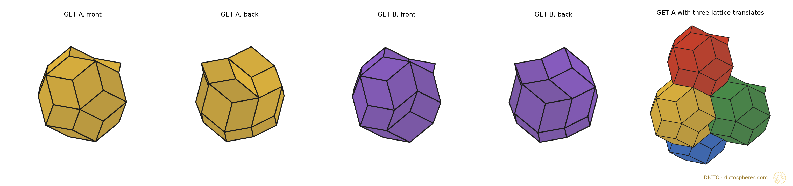

# Grünbaum's zone question at k = 10 (15 November 2026)

**Verdict: we found an answer for k = 10.** Two rhombic monohedral parallelohedra with every zone of exactly 10 faces were found and checked exactly.

The solid: the rhombic triacontahedron with four flat (oblate) golden rhombohedra taken out. DICTO named it the **DICTO Grünbaum–Escher Triacontahedron (GET)**. It comes in two forms, **GET A** and **GET B**.

What each form is and does:
- **Cells:** 16 golden rhombohedra, 10 prolate and 6 oblate.
- **Surface:** 30 congruent golden rhombi, 32 vertices, 60 edges. The surface is a sphere, and no two adjacent faces are coplanar.
- **Zones:** six (one for each 5-fold axis of the icosahedron), each of exactly 10 faces.
- **Tiling:** its translates fill space face to face, on one lattice.

A and B are not congruent, even as mirror images. They share their lattice and their 16 cell types. This repeats Grünbaum's k = 8 pair D1 and D2, which are the rhombic icosahedron with two oblate rhombohedra taken out.

DICTO's gnomon reaches GET as well. Adding one whole zone layer to k = 8 surfaces produces GET A and GET B directly; see "Tools" below.

**Proof status: computer-verified in exact arithmetic** in ℤ[φ]:
- volume equals covolume;
- an exact cell decomposition;
- no overlap with any translate that could reach the solid.

An independent floating-point check agrees: 200,000 random points are each covered exactly once, and no two faces cross.

**Novelty: not found in the sources checked (below), but provisional.** *Update 20 Nov 2026:* Marjorie Senechal replied to DICTO that GET and the Senechal–Taylor solids only share similarities, so GET is not among their three (her reply as reported by DICTO; her exact words to be quoted before any public claim). The full text of Senechal–Taylor 2023 is closed and has not been read. Before any "new" claim it must be confirmed that GET is not among their three nonconvex parallelohedra. The free routes are an NDL copy or a library visit.

**Not claimed:**
- k ≥ 12 is untouched.
- The classification theorem below covers only one class of solids.
- Six further k = 10 candidates (lattices of three kinds) pass the floating-point coverage test but are not yet exactly certified.

*Figure: GET A (gold) and GET B (violet), front and back. Right: GET A with three lattice translates (blue, green, red). The same image is in the reading folder as RENDER-grunbaum-k10.png.*

## The question

Grünbaum, "The Bilinski dodecahedron, and assorted parallelohedra, zonohedra, monohedra, isozonohedra and otherhedra", Math. Intelligencer 32(4) (2010) 5–15; author's version 2/3/10, p. 17 (library copy):

> "Given an even integer k ≥ 4, is there a rhombic monohedral parallelohedron such that every zone has exactly k faces? … No information is available for any k ≥ 10."

The known cases:
- k = 4: the cube.
- k = 6: the rhombic dodecahedra K (Kepler) and B (Bilinski).
- k = 8: Grünbaum's doubly indented rhombic icosahedra D1 and D2.

Grünbaum's polyhedra are sphere-like, and adjacent faces are never coplanar (p. 9). The scoping and the first pilot are in `studies/2026-11-15-backyard-open-problems`, section (b). That pilot reached depth ≤ 2 from the triacontahedron and found 29 candidates, none of which tiles. This study explains why: the first tilers appear at depth 4.

## Prior art and novelty

| Source | Read | Bearing |
|---|---|---|
| Grünbaum, Math. Intelligencer 32(4) 2010 | author's version, pp. 9, 16–18 (library) | the question; D1, D2 |
| Grünbaum, "Tilings by some nonconvex parallelohedra", Geombinatorics 19 (2010) 100–107 | full (author's page, faculty.washington.edu/moishe/branko) | semicrosses and crosses of cubes; a conjecture on patch pairs (p. 105); no k ≥ 10 |
| Senechal & Taylor, "Parallelohedra, old and new", Acta Cryst. A 79 (2023) 273–279, doi:10.1107/S2053273323001444 | **abstract only** (OpenAlex). Unpaywall: closed, no repository copy; IUCr, Wiley and PubMed refused automated access; no arXiv version found | three new nonconvex parallelohedra built from skewed skeletons of Fedorov's five convex ones, and "a counterexample to a statement by Grünbaum" (most likely the 2010 patch conjecture). Whether any of the three is rhombic monohedral with zones of 10 is **unchecked** |
| Hungerbühler, Hungerbühler & Pirron, "New families of monohedral polyhedra", J. Math. Arts 19 (2025) 1–23 | full (author's copy, math.ch) | monohedra and monohedral zonohedra; cites Grünbaum 2010 for the Bilinski dodecahedron only; no parallelohedra, no tilings |
| G. Hart, Virtual Polyhedra, "dissection of the rhombic triacontahedron" | page | the 20-cell dissection (10 "pointy", 10 "flat"); nothing on sub-assemblies that tile |
| Hafner & Zitko, "Introduction to golden rhombic polyhedra" (VisMath) | page | convex golden rhombic polyhedra and zone contraction; "some nonconvex polyhedra are constructed" (not named); no tiling |
| OpenAlex citers of Grünbaum 2010 and of Senechal–Taylor 2023 | listed (earlier study; none for Senechal–Taylor) | none answers the question |

Web searches:
- "Senechal Taylor parallelohedra nonconvex arXiv";
- "nonconvex parallelohedron golden rhombi rhombic triacontahedron indented";
- "Hungerbühler Pirron New families of monohedral polyhedra";
- "George Hart golden rhombohedra assemblies … space filling".

**Verdict on novelty:** GET is not found in any source read. Senechal–Taylor is the one source that could contain it, and it is unread. Their construction starts from skeletons of the truncated octahedron and the other Fedorov types, which makes a 30-face golden-rhombic solid unlikely, but this is not checked. Status: **provisional until Senechal–Taylor is read**. No source was bought.

## The solids

Notation:
- The six 5-fold axes, indexed 0–5, are (1, φ, 0), (−1, φ, 0), (0, 1, φ), (0, −1, φ), (φ, 0, 1), (−φ, 0, 1).
- Any two of them span the same golden rhombus: diagonals 2 and 2φ, side √(φ + 2). So every solid built from golden rhombohedra on these axes is monohedral.
- A cell (p; ijk) is the box p + [0,1]eᵢ + [0,1]eⱼ + [0,1]eₖ, with p in ℤ⁶.

**GET A** (candidate 0; exact faces with outward sides in `data/search6.json`, cells and lattice in `data/tile12.json`):
- **Cells:** (010000; 025), (000000; 012), (011000; 035), (000000; 024), (011100; 045), (000001; 123), (101000; 134), (001100; 145), (000000; 125), (000100; 245), (000000; 234), (000000; 235), (001100; 014), (001000; 034), (001000; 013), (001000; 135).
- **Lattice basis** (in ℤ⁶): (1, 0, 0, −1, 0, −1), (0, −1, 0, 0, 1, −1), (0, 0, 1, 1, 1, 0).
- **Volume = covolume** = 20 + 32φ in these units (≈ 71.777). Removing four oblate cells from the triacontahedron leaves 16 of its 20 cell types: the missing types are 015, 023, 124 and 345, and each axis occurs in exactly two of them.
- **Adjacent faces:** their outward normals meet at 36°, 72° or 108°, never at 0°, so no two adjacent faces are coplanar.

**GET B** (candidate 1) has the same lattice and the same cell types, arranged differently. No translation combined with one of the 120 symmetries of the six-axis star maps A to B, and those are the only possible congruences, because a congruence must map the six edge directions to themselves.

**Where they come from.** Four corner indentations of the triacontahedron produce them. Each indentation removes one rhombohedron at a 3-valent corner, which keeps all 30 faces and every zone at 10.
- At depth 3 there are 10 classes, all with face-pair rank 6.
- At depth 4 there are 29 classes. Exactly three of them have rank 3: A, B and a third (candidate 2) with the same lattice and cell types.

## Why exactly these: the face-pair lemmas and three filters

**Class C(n)** is the set of closed sphere-like surfaces of golden rhombi on n of the axes, with one zone per axis and every two zones crossing exactly twice. Such a surface has F = n(n − 1) faces and k = 2(n − 1) faces in each zone.

**Lemma 1 (zone words).** Walk once round zone a. Each face is crossed by a step ±e_c, where c is its other axis.
- The walk closes, and the axes are independent in ℤⁿ, so the two c-faces carry opposite signs.
- So λ_ac, the vector from one (a, c) face to the other, is the sum of the signed letters strictly between the two c's.
- Its entries are 0 or ±1. It is zero at a and at c, and λ_ac ≠ 0.

**Lemma 2 (lattice).** In a face-to-face lattice tiling, each face is matched by the other face of its pair on a neighbour.
- So every λ_ac lies in the lattice. The λ's span a rank-3 lattice L ⊂ ℤⁿ, with covolume |Σ p_ijk(L) det(eᵢ, eⱼ, eₖ)| (Cauchy–Binet).
- If the two faces of a pair face the same way, P cannot tile by translations at all.

**Lemma 3 (cell counts; for P a union of golden rhombohedra).**
- In the torus ℝ³/Λ, the dual surfaces of the families i, j, k meet with algebraic intersection number p_ijk(L), and each triple point is a cell of type ijk.
- So N_ijk ≥ |p_ijk|. Then volume = covolume forces N_ijk = |p_ijk| and p_ijk·det(eᵢ, eⱼ, eₖ) ≥ 0 for all types (sign coherence).

**Exhaustive filters (`vclass2.py`, `vclass3.py`).** Lemma 1 forces V = rowspace[I | X] with X ∈ {0, ±1}^{3×(n−3)}, up to relabelling.

| n (k) | subspaces | zone words fit | pairs agree, rank 3 | sign-coherent golden / twin | cells |
|---|---|---|---|---|---|
| 5 (8) | 729 | 192 | 192 | 5 / 3 | 8 of 10 types (icosahedron − 2 oblate); D1/D2's lattice is among them |
| 6 (10) | 19,683 | 768 | 768 | 5 / 3 | 16 of 20 types (triacontahedron − 4 oblate) |

(The counts are representatives of the form [I | X], not classes up to relabelling.)

**Theorem (computer-verified in exact arithmetic).** Every face-to-face lattice tiler in class C(6) that is a union of golden rhombohedra has exactly 16 cells, one of each of 16 of the 20 types: it is the triacontahedron less one oblate cell of each of four types. GET A and B realise this. At k = 8 the analogue is the icosahedron less two oblate cells, realised by D1 and D2.

**Unresolved (float evidence only).** The flip search to depth 12 also gives five rank-3 surfaces at depths 10 and 12 whose lattices are *not* sign-coherent:
- candidates 3–6, with volume 14 + 20φ;
- candidate 7, with volume 8 + 16φ.

For all five, covolume equals volume exactly. The surface ray-parity test covers 20,000 of 20,000 points exactly once in each. Their tracked cell sets carry negative entries, and exact peeling found no decomposition. By Lemma 3, if they tile they are not unions of golden rhombohedra. This tension is not resolved: they are either a second kind of k = 10 tiler or a gap in our reading of Lemma 3. Candidate 2 (GET's own lattice) is also covered exactly once but has no exact certificate. All six are **reported as undecided**.

An earlier, weaker filter (`vclass.py`, Plücker ratios in {0, 1, 2}) left 610,000+ survivors at n = 6. Lemma 1's sharp form made the problem small.

## The tools DICTO asked for, and what each gave

**Gnomon** (*The Golden Cycle*, Ch. 14: the shell that, added to a solid, gives the next solid; after Euclid and Heron).
- How it was read here: the shell is one whole zone layer. Cut a k = 8 surface along a closed edge path with two edges of each direction, shift one side by e₆, and close the cut with ten rhombi (d, 6). Every old zone grows from 8 to 10, and the new zone has 10 (`gnomon.py`). The convex case is the step from the rhombic icosahedron to the triacontahedron (control met). It is a gnomon "by zones": the new solid is not similar to the old one.
- What it gave, from all 18 class C(5) sources (flip depth ≤ 3 from the rhombic icosahedron):
  - 19,048 cut paths, giving 23,255 distinct k = 10 surfaces;
  - ranks: 22,093 rank 6, 1,145 rank 5, 17 rank 3;
  - of the 17, six have degenerate lattices (exact det 0), and eight are covered three times (not embedded);
  - **three are covered exactly once, and they are GET A, GET B and candidate 2** (same canonical forms). So the gnomon grows GET in one step from a k = 8 surface. Which sources (`gnomon_source.py`): of the 18 k = 8 sources, exactly two reach GET, and they are the two k = 8 tilers of the flip search (Grünbaum's D1/D2 type). One gives GET A, GET B and candidate 2; the other gives GET A and GET B. The other 16 reach none of them. **So GET is a k = 8 parallelohedron of Grünbaum's type with one zone layer added: DICTO's gnomon step taken from k = 8 to k = 10.**

**Corner indentations** (Grünbaum's D1/D2 construction, generalised).
- How: indent or bulge one golden rhombohedron at a 3-valent corner; this keeps the face count and every zone size. Each move passes an exact embedding test (`k10_search.py`).
- What it gave:
  - On 5 axes, exactly two tilers (D1/D2 type) at depth 2, and their depth-3 neighbours fail (control).
  - **On 6 axes, GET A and B at depth 4.**
  - To depth 12: 4,827 classes, of which 8 have rank 3.

**Exact-cover tiling check** (#100 Thm 2.4: tiling = no overlap plus full cover; density 1 from covolume = volume).
- How: exact covolume = volume in ℤ[φ], then an exact separating-axis test over all translates within twice the circumradius (`tile_check.py`).
- What it gave: GET A and B tile. The D1/D2 control tiles.

**Double Vision** (Galois twin, √5 → −√5).
- How: Lemmas 1 and 2 are combinatorial, so a solid and its twin share the face-pair rank. Lemma 3 was run for both.
- What it gave: the twin of the six-axis star is a six-axis star again (scaled by φ, relabelled), so twin solids in C(6) are golden ones with new labels. 5 golden and 3 twin representatives, all with the same 16-cell pattern. Nothing beyond relabelling.

**Dehn test** (#100). Every candidate built from golden rhombohedra (parallelepipeds) has Dehn invariant 0, so the test cannot exclude anything here.

**Kaleidohedra lattice moves** (#50). Their moves build convex classical space-fillers. A convex parallelohedron has belts of 4 or 6 only (Venkov–McMullen), so no k ≥ 8 example can be convex. Not run.

**Cleo and Antonius.** CLEO is a triangular pyramid (#19); Antonius is a golden rhombohedron with both tips cut off (#44). Both have non-rhombic faces, so neither can be a piece of a rhombic monohedral surface. The golden rhombohedra themselves are the cells throughout.

**Rhombiverse / Polyhedraverse registry.** The rhombohedron, Bilinski, rhombic icosahedron and triacontahedron (the six-axis zonotope family) were used as starts and controls.

## Method and checks

- **Arithmetic:** exact in ℤ[φ] throughout (integer pairs, signs decided by integer tests). Floating point is used only in the independent checks and the figure.
- **Embedding:** for each flip, no other face may meet the open cell, and a face that only touches the closed cell must share a lattice vertex with it (conservative).
- **Controls:**
  - the rhombohedron and Bilinski forms tile;
  - the triacontahedron does not;
  - on 5 axes exactly two tilers, D1/D2 type, appear (rank 3, covolume = volume, no overlap);
  - their neighbours fail;
  - the D1/D2 lattice survives all filters at n = 5;
  - zone-layer insertion into the rhombic icosahedron gives the triacontahedron.
- **Independent check (`verify_k10.py`), GET A and B both pass:**
  - closed 2-manifold, χ = 2, zones 10 × 6;
  - no coplanar adjacent faces;
  - one face shape (side √(φ + 2), diagonals 2 and 2φ);
  - 0 face crossings;
  - 200,000 / 200,000 random points covered exactly once;
  - face to face;
  - volume = covolume (≈ 71.7771).
- **Not covered:**
  - solids outside class C(6): other face counts, zones crossing more than twice, other rhombi;
  - lattice tilings that are not face to face.

**Runs** (each ended FINAL ok; nothing left running):
- `k10-vclass-pilot`, `k10-vclass2`, `k10-vclass3`: the filters.
- `k10-search6-pilot`, `k10-search6`: the flip search to depth 12, 23 min.
- `k10-tile4`, `k10-tile12`: the exact tiling checks.
- `k10-verify`: the independent check.
- `k10-cover`, `k10-gcover`: surface coverage of the flip and gnomon candidates.
- `k10-gnomon`: zone-layer insertion, 34 min.
- `k10-compare`: canonical identification.
- `k10-gsrc`: gnomon sources.

The runs were split across the two compute hosts.

## Credits

- The question and the k = 8 solids D1, D2: Grünbaum (2010).
- The Bilinski dodecahedron: Bilinski (1960).
- Nonconvex parallelohedra: also Senechal & Taylor (2023, not yet read).
- Belts of convex parallelohedra: Venkov (1954), McMullen (1980).
- The torus intersection numbers and Cauchy–Binet are standard.
- The six-axis golden-rhombohedron model and the first pilot come from the earlier back-yard study.
- The gnomon is from DICTO's *The Golden Cycle*, Ch. 14 (after Euclid and Heron).
- The figure uses `figlib.py` from the 2026-11-13 study.
- The name GET is DICTO's.
- Computation by Claude (Anthropic) for DICTO.

## Files

- `scripts/zsurf.py`: exact surfaces, flips, zones, face pairs, lattice test.
- `scripts/k10_search.py`: the flip search.
- `scripts/gnomon.py`, `scripts/gnomon_lib.py`, `scripts/gnomon_source.py`: the zone-layer gnomon and its sources.
- `scripts/vclass.py`, `scripts/vclass2.py`, `scripts/vclass3.py`: the filters.
- `scripts/tile_check.py`: the exact tiling check.
- `scripts/verify_k10.py`: the independent check.
- `scripts/cover_surface.py`: the surface coverage test.
- `scripts/compare.py`: canonical identification.
- `scripts/render2.py`: the figure.
- `data/`: JSON outputs and logs (`vclass.json`, 1.8 MB, superseded, is kept only on the compute host).
- `figures/grunbaum-k10-tilers.png`: the figure.

## For the GET paper (DICTO, 17 Nov 2026)

**Bridge sentence (to go in the paper):** GET is built entirely from the two golden rhombohedra of the three-dimensional Penrose tiling (Ammann, 1976; Kramer, 1982), the building blocks of icosahedral quasicrystals, yet its translates fill space on a lattice: a periodic crystal assembled from quasicrystal pieces, a bridge between the periodic and the aperiodic. Like every parallelohedron, it cannot force aperiodicity (it always admits its lattice tiling); Inchbald notes the same for his dimpled triacontahedron, that further rules would be needed for a quasiperiodic structure.
