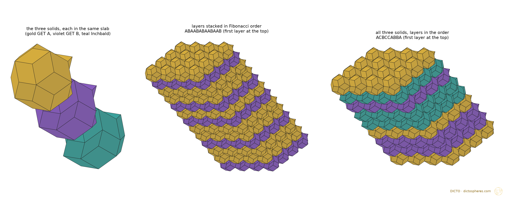

# Mixing GET A, GET B and Inchbald's solid in one tiling (17 November 2026)

**Question (DICTO):** can the three k = 10 solids, GET A, GET B and Inchbald's dimpled triacontahedron (candidate 2, here "C"), be mixed in one tiling of space? Does mixing, or any placement that is not a lattice placement, give non-periodic tilings? This serves the bridge aim: GET is a periodic crystal made of the golden rhombohedra of the 3D Penrose tiling.

**Answer in one line:** yes. All three solids can be mixed face to face. Whole layers along a common lattice plane can be stacked in any order: AB, ABC, a Fibonacci word, anything. GET A and GET B can even be chosen independently on every line of the lattice in one direction v. So non-periodic tilings exist, all proved exactly. None of them is aperiodic in the strong sense: every one keeps a period along v, and the lattice tiling is always available.

*Figure:*
- *Left: the three solids, each filling the same slab (gold GET A, violet GET B, teal Inchbald's solid).*
- *Middle: layers of GET A and GET B stacked in the Fibonacci order ABAABABAABAAB.*
- *Right: all three solids, in the layer order ACBCCABBA.*
- *The layers are pulled apart slightly along the stacking direction so that each one can be seen. The first letter of each word is the top layer.*
- *Both patches are checked exactly (§4).*

## Results

Status labels: **proved** = exact arithmetic in ℤ[φ] or ℚ(φ), or an exact combinatorial argument with every step computed exactly; **local** = an exact SAT result inside a finite box (UNSAT in the box is a proof; SAT in the box is not).

### 0. Inchbald's solid tiles by translation: now exact (proved)

`pilot_lib.py` gives C an exact signed decomposition:
- the 17 cells of a fine tiling of T that holds three of its four removed corner cells, plus one;
- the fourth corner cell, minus one.

Overlap volumes are then computed exactly in ℚ(φ):
- separating-axis test on the 15 face normals, which is exact for two cells;
- for crossing cell pairs, vertex enumeration of the 12 half-spaces and facet fans.

Results:
- volume = covolume = 20 + 32φ;
- the exact overlap volume with each of its 14 lattice translates within 2R is 0.

This upgrades §3 of the 2026-11-17 Inchbald study from floating point to exact. Lattice basis (Inchbald's position): (1,0,0,−1,0,−1), (0,−1,0,1,1,0), (0,0,1,1,1,1).

Controls:
- the same code gives GET A and GET B volume = covolume and 0 overlapping translates;
- the exact volumes of the removed corner cell meeting each of the 7 cells it crosses agree with floating-point polytope volumes (scipy, a one-off check during the pilot).

### 1. Face-to-face neighbours (proved)

The search space is every image of Y under the 120 symmetries (rotations and reflections), translated so that one face of Y lies exactly on a face of X with opposite outward sides. Face contact forces the translation into ℤ⁶. For a given image and a given face of X there is exactly one candidate, so the list is complete. Overlap is decided exactly by the tests of §0.

| centre X | A neighbours | B neighbours | C neighbours |
|---|---|---|---|
| GET A | 588 | 784 | 196 |
| GET B | 588 | 784 | 196 |
| C | 588 | 784 | 196 |

(`neighbours.py`, `data/neighbours.json`: every placement with its shared faces.)

- The rows agree because the three solids are all T less four corner cells. The counts pass the inversion check: 588/30 = 784/40 = 196/10 = 19.6 valid faces out of 30 per image pair (30, 40 and 10 are the numbers of distinct images).
- Every pair of the three solids, mixed ones included, meets face to face in many ways.

### 2. Mixed coronas (proved, by construction)

Mixed coronas exist, of every kind asked about. They are proved by the exact patches of §4, whose inner tiles have all 30 faces matched and no overlaps:
- an A tile among B tiles;
- a B tile among A tiles;
- a C tile among A and B tiles;
- an A or B tile next to C tiles.

The full enumeration of all face coronas by exact cover / SAT is **not done**. The pairwise exact conflict test among about 1,500 candidate neighbours, about 10⁶ pairs, was too slow within the run limits, mostly because C's overlaps need exact volumes. See LEADS.

### 3. Tilings of space: layers, lines, Fibonacci (proved)

**Layer theorem (`layers.py`).** Setup:
- Take any image g·Y of a solid, with face-to-face lattice L_g.
- Take any primitive functional h on L_g with |h(λ)| ≤ 1 for all 30 face-pair vectors λ. Then every neighbour of a tile lies in its own layer or the next one up or down.
- The layer g·Y + ker h has a top surface (the faces with h(λ) = +1) and a bottom surface (h(λ) = −1), both periodic modulo ker h.

If two layer types share the plane lattice ker h, and some w ∈ ℤ⁶ gives Top_V + w = Top_U and Bot_V + w = Bot_U as face sets modulo ker h, then:
- the slab of U is filled exactly by a V-layer;
- the slabs stack, because U's lattice tiling is the stack of its layers;
- so every slab can be filled independently, and every finite or infinite word gives a face-to-face tiling.

The search covered every image (up to translation) of A, B and C and every admissible h:
- 480 layer types (A 180, B 240, C 60);
- **572 swappable pairs**: A–B 308, A–C 56, B–C 60, A–A 60, B–B 88, C–C 0.

The plane h = (1, 0, −1) (in GET's lattice basis b1, b2, b3) takes all three solids at once:
- A-layer: GET A;
- B-layer: GET B in the same place (w = 0);
- C-layer: Inchbald's solid, image g13, shifted by w = (1,1,1,1,1,1).

So any word in A, B, C is a tiling. Fibonacci gives non-periodic ones.

**Lines, GET A and GET B (`decorated_lattice.py`, `decorated_sft.py`).** Put GET A or GET B, both unrotated, at every point of their common lattice L.

The exact pair table:
- all pairs within reach were tested exactly (bounding spheres with a 10⁻⁶ margin as a conservative prefilter);
- the only overlapping pair is A at t with B at t + v, where v = −b1 + b2 − b3;
- every allowed contact is face to face.

The local SAT rule (no forbidden pair, plus every face matched by an identical opposite face):
- A and B cannot sit at ±v or ±2v of each other; this is UNSAT in a box of radius 4, so it is proved;
- so each line t + ℤv carries one solid only.

Conversely, every assignment that is constant on lines is a tiling:
- any finite part of it occurs in a configuration that is periodic on a torus, constant on lines and free of overlaps;
- such a configuration has density 1 and is periodic, so it is a tiling.

**Theorem:** the tilings of this kind are exactly the free choice of A or B on each line parallel to v, one free bit per point of ℤ².

Consequences:
- Any 2D pattern of bits gives a tiling: random, Fibonacci in two directions, or a Penrose-coded 2D pattern.
- Choosing a 2D pattern with no period gives a tiling whose only translations are the multiples of v.
- Every such tiling keeps v as a period.

Torus counts agree with this. For A and B unrotated, there are 2^{n²} periodic tilings on the n×n×n torus: 16 at n = 2 and 512 at n = 3.

A correction made during the study: a non-periodic packing of density 1 can still leave holes. Without the local face condition, the pair table alone also allowed "switches" along a line, A above B. The exact patch shows that a switch leaves unmatched faces (`free_patch.py` control, 25 of 27 inner tiles matched), and the local rule forbids it.

**The wider decorated lattice.** The study collected 11 placements with lattice exactly L, reached from A by direct swaps:
- A in 5 placements, B in 4, C in 2;
- with them, the periodic tilings of the 2×2×2 torus number 7,343, and those of the 3×3×3 torus number over 20,000 (count capped).

How rich the full 11-shape system is (in particular, whether it has tilings with no period at all) is **open**.

### 4. A single solid alone (proved for A and B; for C, a partial negative)

**GET A alone (proved).** A has 60 same-solid layer swaps. Two examples:
- A ↔ A in image g40, offset (0,0,0,1,1,0), on the plane h = (0, 0, 1);
- A ↔ A in image g24, on h = (1, 0, 0).

So A-layers in two orientations stack in any order: non-lattice tilings by GET A alone, uncountably many, including non-periodic ones.

The exact patch (`free_patch.py A2`): 343 tiles, two placements of A chosen at random per plane c3 = const. Every one of the 27 inner tiles has all faces matched, with no overlap.

The local rule (`decorated_sft.py`): A and A(g40) cannot sit in the same plane c3 = const at lattice distance ≤ 2 (UNSAT in the box). So this freedom is layer by layer, not line by line.

**GET B alone (proved):** 88 same-solid layer swaps, with the same layer freedom.

**Inchbald's solid alone (partial negative):**
- it has **no** same-solid layer swap among its 60 layer types;
- its two placements in the decorated lattice (images g12 at offset 0 and g13 at offset (1,…,1)) cannot occur together at any λ with |λᵢ| ≤ 2 (box UNSAT for all 124). The step graph on L is connected, so in that model they never mix;
- non-lattice tilings of C alone are therefore **not found**, but not excluded in general: images outside this model, and slides that are not face to face, are untested.

C does mix with A and B (§3).

### Exact patches (evidence for §2–§4)

| patch | tiles | pairs tested exactly | overlaps | inner tiles, all 30 faces matched |
|---|---|---|---|---|
| Fibonacci ABAABABAABAAB, 4×4 per layer | 208 | 1,017 | 0 | 44 / 44 |
| ACBCCABBA, 4×4 per layer | 144 | 689 | 0 | 28 / 28 |
| A/B random per v-line, 7³ | 343 | 1,854 | 0 | 27 / 27 (control: a switch leaves faces unmatched) |
| A/A(g40) random per plane, 7³ | 343 | 1,854 | 0 | 27 / 27 (control: a switch inside a plane leaves faces unmatched) |

## What this means for the bridge

GET A, GET B and Inchbald's solid are one family that can be crystalline or not:
- one solid on its lattice is a crystal;
- layers in a Fibonacci order give a stack that is ordered but non-periodic;
- independent lines of A and B give tilings periodic in one direction only.

This is the crystallographers' polytypism (stacking variants, as in close packings ABC…), here built from the two golden rhombohedra of icosahedral quasicrystals. It is a real bridge between the periodic and the non-periodic. It is **not** aperiodicity:
- every tiling found keeps all tiles on lattice positions;
- every one keeps the period v;
- the plain lattice tiling is always allowed.

Forcing aperiodicity would need extra rules, as Inchbald notes.

## Method

- **Exactness.** Solids are signed cell lists in ℤ⁶ on the six 5-fold axes, with `zsurf.py` copied unchanged from the 2026-11-15 study. Arithmetic is exact throughout:
  - ℤ[φ] integer pairs for projections and separating-axis tests;
  - ℚ(φ) Fractions for C's intersection volumes;
  - integer linear algebra in ℤ⁶ for lattices and kernels;
  - pysat (CaDiCaL) for exact cover and the local rule.
- **Floating point is used only in conservative prefilters.** Bounding spheres use a 10⁻⁶ margin, against float errors near 10⁻¹². Every decision near a margin is re-decided exactly.
- **Controls:**
  - A, B and C each tile by their own lattice (`pilot_lib.py`);
  - the transforms are consistent (faces of transformed cells = transformed faces, for all 120 symmetries);
  - each shape has no forbidden pair with itself;
  - a forbidden pair or switch put into a patch is detected.
- **Runs.** All on the compute host, in the foreground, each under 10 minutes, each ending in a FINAL line (all `FINAL ok`):
  - `pilot_lib.py`, `neighbours.py` (counts), `layers.py`, `decorated_lattice.py`, `decorated_sft.py`;
  - `patch.py` (pilot and two patches), `free_patch.py` (AB, A2), `fig.py`.
  
  Nothing is left running.

## Prior art and credits

- Grünbaum, Math. Intelligencer 32(4) (2010): the k = 10 question. GET A and B are from study 2026-11-15; the name GET is DICTO's.
- G. Inchbald, "A 3-D Quasicrystal Structure?", steelpillow.com: the dimpled rhombic triacontahedron (2022–23). He notes that further rules would be needed for quasiperiodicity; this study confirms that mixing alone does not force it.
- Layer stacking with free stacking order is the standard notion of polytypism and stacking faults in crystallography (close packings, Barlow).
- The 3D Penrose rhombohedra: Ammann (1976), Kramer (1982).
- **Sources checked for this study:** only the two earlier study READMEs and their sources. No new literature search was made, so mixed GET/Inchbald tilings are **not** claimed as new.
- Computation by Claude (Anthropic) for DICTO.

## LEADS

1. **Full face-corona enumeration (Q2, exhaustive).** It needs a faster exact conflict test for about 1,500 candidate neighbours, for example exact integer vectorisation, or C's overlap via T minus corners instead of volumes.
2. **The 11-placement decorated lattice.** Does it admit tilings with no period at all (several line or plane directions combined)? Torus counts grow fast (7,343 at 2³). Settle it by a local-rule analysis like the A/B line theorem.
3. **Inchbald's solid alone.** Test images outside the decorated model and non-face-to-face slides, for a full yes or no on non-lattice tilings.
4. **Flip-connectivity of the tilings of T.** If proved (it may follow from known results on extension spaces of rank-3 oriented matroids), it would turn the Inchbald study's "no 16-cell decomposition among 160" into a theorem.
5. **For the paper:** the A/B line theorem is short, exact and visual (one free bit per line), and could be the "bridge" figure. Placement in the GET paper or the Concordance is DICTO's call.

## Files

- `scripts/`: `mixlib.py` (the solids, the symmetries, the exact overlap test); `pilot_lib.py`; `neighbours.py`; `layers.py`; `decorated_lattice.py`; `decorated_sft.py`; `patch.py`; `free_patch.py`; `fig.py`; `zsurf.py` (copy).
- `data/`: JSON and logs of every run. `inchbald-source.json` is a copy of the Inchbald study's surface data.
- `figures/get-mixing.png` (also in the reading folder as PREVIEW-get-mixing.png).
